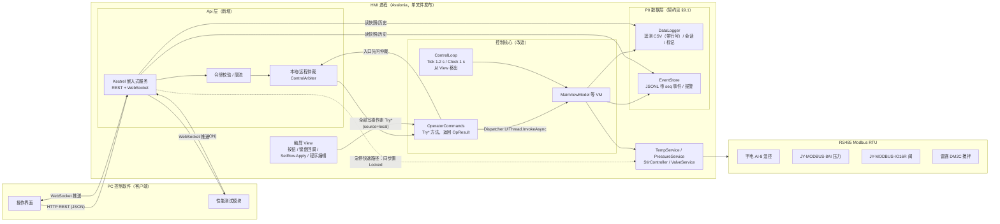
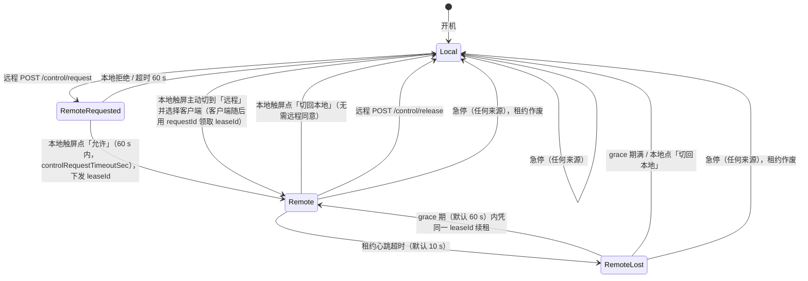

# ParallelReactor HMI 对外通讯接口设计（草案 v0.5）

> 状态：**P2 只读接口（`api-phase1`）、P3 控制权与写接口、P4 测试会话（`api-phase3`）已实现**，代码在 `Api/`、`Api/Hmi/`、`Commands/ControlLease.cs`、`Service/EventStore.cs`、`Service/SessionManifest.cs`，本文仍是协议的唯一依据；实现与本文不一致之处集中列在 §14.1（P2）与 §14.2（P3 / P4）。评审人：项目负责人、主管。
> 适用代码：`ParallelReactor-avalonia`，分支 `p0-logging-api`（Avalonia 11.1 / .NET 8 / CommunityToolkit.Mvvm）。
> **依据**：以 `p0-logging-api` **工作区现状**为准（HEAD `88b8d43` 之上已有未提交的 P0 代码：`Service/DataLogger.cs`、`Service/TelemetryCsv.cs`、`Service/CommStats.cs`、`Models/OverTempGuard.cs`、`Models/LeakRecord.cs`、`Models/LeakFit.cs`、`ViewModels/MainViewModel.Logging.cs`，另改了 15 个文件）。
> 文中路径都相对于仓库根目录。文件简称：`MVM` = `ViewModels/MainViewModel.cs`，`Log` = `ViewModels/MainViewModel.Logging.cs`，`Estop` = `ViewModels/MainViewModel.Estop.cs`，`Gas` = `ViewModels/MainViewModel.Gas.cs`，`Drawer` = `ViewModels/DrawerViewModel.cs`，`Prog` = `ViewModels/ProgramViewModel.cs`，`Run` = `ViewModels/ProgramViewModel.Run.cs`，`Leak` = `ViewModels/LeakViewModel.cs`，`Set` = `ViewModels/SettingViewModel.cs`，`Temp` = `Service/TempService.cs`，`DL` = `Service/DataLogger.cs`，`TCsv` = `Service/TelemetryCsv.cs`。
> **引用以方法名为准**，行号只是工作区当时的近似位置（P0 改动仍在进行，行号会继续偏移），定稿时统一刷新一次。
> 风险编号 H1–H18 和动作判定 A/B/C 引自《远程控制面清单》（只读审查结论），本文不再重复全部论证。

### 修订记录

| 版本 | 内容 |
|---|---|
| v0.1 | 初稿（以 HEAD `88b8d43` 为依据） |
| v0.5 | **P3 控制权与写接口、P4 测试会话已实现**（分支 `api-phase3`）：§5.3 租约状态机（`Commands/ControlLease.cs`，申请超时改为 60 s）、`/control*` 五个端点、`X-Control-Lease`、心跳 / RemoteLost / 宽限 / `onRemoteLost`（keep / stopHeat / estop 三种都已实现）、触屏「允许 / 拒绝」弹窗与顶栏「切回本地」、`autoGrantRemote`；§7 写端点（急停、停止类、通道、温度、曲线、PID、自整定、搅拌、程序 PUT / run / abort / copy、泄漏测试、报警确认）全部经 `UiCommandBridge` 进 UI 线程（503 / 504 / HW_UNCONFIRMED 语义）；§7.1 响应形状、`opId`、`opEventSeq`、`Idempotency-Key`（428 / 重放 / mismatch / in-progress）；审计 `op.*` / `control.*` 显式 kind；WS `control` / `opEvent` / 带租约的 `hb`；写限流；§10 会话（manifest、标记、归属、interrupted）。偏差与形状见 §14.2。多程序并行：每通道一份 `ProgramRun`、最多 8 个程序同时执行；§6.3 新增 `channels[i].program` 与顶层 `programs`，顶层 `program` 标废弃（过渡一个版本）；§7.7 搅拌引用计数（程序之间）已实现；§7.9 程序接口按通道（`DELETE /channels/{id}/program/run`）；新增 §7.12「气路排队与稳压脉冲取舍」；§9.2 运行记录末尾追加 8 列 `RVx_程序步`；§15 Q7 / Q14 改为已实现。审查修订：稳压脉冲间隙 / 程序排队对泄漏测试与手动阀控仍视为占用；程序租约的报警隔离（§7.12 第 4、7 条）；队首复查不通过改为继续等待；稳压脉冲前复查 / 脉冲期气路故障按程序故障；搅拌转速释放恢复（第 9 条）；退出程序时租约取消按手动中止；`program`（废弃）无程序时沿用最近终态；`programs.waitingGas` 只列真正等待的通道；`ApplyValvesAsync` SV 参与通道断言；等待计时改单调时间。**第二轮审查修订（安全 / 并发）**：幂等表按令牌隔离、IN_PROGRESS / MISMATCH 拒绝不再撤掉别人的 in-progress 条目、HW_UNCONFIRMED 的幂等条目等尾部结束才登记最终结果；客户端断线后已投递的命令照常执行并审计 / 回填幂等表；`leaseId` 不再进 WS 广播，`GET /control/requests/{id}` 须带申请凭据 `X-Control-Request-Key`（`requestKey`）才给 leaseId；仲裁器在租约锁内同步切换（并发授权 / 过期不再互相作废），迁移按序送达；clientName 清洗（控制 / 格式字符）、弹窗与顶栏显示令牌名、`StartedBy` 标签附带令牌名；审计明细带 `ip / leaseId / 令牌`；拒绝 / 超时后同令牌 30 s 冷却；宽限期内同客户端可直接重新申请；停止类放行 `estop` 权限位；`/estop` 与心跳各自独立限流分区；`"estop": false` 可收回 operator / admin 的急停权限；错误正文不含异常原文；`GET /sessions.current` 与 `/sessions/current` 同源；interrupted 的 `endedAt` 取会话 CSV 修改时间 |
| v0.4 | P2 评审整改：§4.2 鉴权失败按 IP 限速、§4.3 P2 只有 HTTP、§6.1 `hardware` 四模块键一致、§6.4 `system.settingsChanged / clientConnected / clientDisconnected`、§7.2 `/preflight` 纯计算 + 独立限流、§8.4 `gap` 命名统一与中枢队列溢出处理、§9.2 表格修正、§9.3 跨表头按列名映射、§13.2 事件 seq 严格有序、§14.1 新增偏差行（线程池下限、HTTPS、审计限频、`/files` 尾读） |
| v0.3 | P2 只读接口落地：§3.3 配置文件路径与环境变量、§1.4 / §6.1 `PR_CHANNELS` 默认 1–8、§6.3 `startedBy` / `estop.latched`、§6.4 `kind` 推导与 `origin` 字段、§7.2 `/preflight` 形状、§7.10 `/alarms`、§8.2 `ping / pong / gap / subscribed`、§8.4 环 5000 与背压数、§9.2 实现子集、§11 已发出的错误码、§14 P2 完成；新增 §14.1 偏差清单与《接口使用说明》 |
| v0.2 | 按《v0.1 评审意见》对照工作区代码修订：新增 §9.1「P0 交付契约」；超温切断 / 泄漏测试落盘已实现，改写 Q8、C7、C10；远程急停定位为软件停机请求并独立执行路径；控制权改为租约（`leaseId`）；停止类动作不受控制权约束；`stopHeat` 重新定义；补 `/run` 报警通道、程序占用、程序 schema、`accepted / confirmed`、504 语义、幂等必填、序号纪元、`simulated` 等；错误码补齐；行号改为按方法名引用 |

---

## 目录

1. 目标与范围
2. 总体架构
3. 传输与端口
4. 认证与安全
5. 本地 / 远程切换规则
6. 数据模型
7. REST 接口列表
8. WebSocket 推送
9. 历史数据与文件下载
10. 测试会话接口
11. 错误码
12. 版本管理与兼容
13. 并发与一致性
14. 实施步骤
15. 待确认问题
- 附录 A：Modbus TCP 寄存器表初稿（第二阶段）
- 附录 B：不对外暴露的动作及原因
- 附录 C：接口落地前必须先修的现有缺陷

---

## 1. 目标与范围

### 1.1 目标

1. 让**自研 PC 控制软件**（以下简称「客户端」）通过局域网连接 HMI：
   - 实时看 8 个通道的温度、压力、阀态、搅拌、程序进度、报警；
   - 在「远程」模式下下发操作（启停加热、改设定值、下发程序、泄漏测试、急停等）；
   - 承载**性能测试模块**：引导式测试、实时进度、测试报告。它需要「测试会话」和「打点标记」，并能按时间段取回原始数据。
2. HMI 上的 **P0 数据记录器（DataLogger）和事件存储（EventStore）是唯一的事实来源**。客户端只是查看者和指令发起方，掉线后可以按序号续传，不需要自己补数据。
   **前提**：P0 必须满足 §9.1「P0 交付契约」（事件带 `seq` 且不丢、遥测带行号、会话元数据和标记独立落盘、时区约定写死）。现有 `DataLogger` 还不满足（写失败丢行、事件无 `seq`、会话 id 不唯一），契约未交付前，本条只是目标，§8.4 重同步和 §10 会话接口不能上线。
3. 为第二阶段的**第三方 SCADA 集成**（Modbus TCP，可能还有 OPC UA）留好数据模型。第二阶段以只读为主。

### 1.2 不变的原则

| 原则 | 含义 |
|---|---|
| 安全逻辑留在 HMI | 超温 / 超压判定、急停、气路互斥、程序步骤安全检查全部在 HMI 本机执行，**断网时照常工作**。客户端不参与任何安全闭环 |
| 服务端校验 | 每条远程命令都在服务端用**与触屏完全相同**的守卫重新校验（钳位、状态、互斥），不信任客户端已经做过的检查 |
| 单一操作权 | 同一时刻只有一方（本地触屏或远程客户端）拥有「启动 / 改设定 / 下发」类操作权。**急停和停止类动作不受控制权约束**，两边任何模式下都允许（见 §5.1） |
| 远程急停不是安全功能 | 远程急停是**软件停机请求**，不是 ISO 13850 / IEC 60204-1 意义上的急停安全功能；现场必须有硬接线急停（软件读不到硬件急停回路，见 `BuildPreRun`）。见 §5.2 |
| 接口单位固定 | 接口一律用固定单位：温度 ℃、压力 **psi**（与内部单位一致，见 `Reactor.P`）、转速 rpm、时间 ISO-8601 / 秒（时区约定见 §6 开头）。**不跟随** HMI 的显示单位 `Units.Pressure`（H17） |

### 1.3 范围

| 本期（第一阶段）包含 | 本期不包含 |
|---|---|
| HTTP REST + WebSocket 服务（内嵌在 HMI 进程中） | Modbus TCP / OPC UA（第二阶段，附录 A 只给初稿） |
| 本地 / 远程切换与仲裁 | 互联网 / 云端访问、跨网段穿透 |
| 遥测、事件、报警推送；历史与 CSV 下载 | 多 HMI 集中管理 |
| 通道级操作、程序管理与下发、泄漏测试、测试会话 | 配方库管理（`MVM.Recipes` 目前始终为空，无数据源） |
| 只读的设置 / 阈值查询；少量管理员可写项（可选） | 维护类操作的远程化（细分、EEPROM 电流、Ctn 修复、满量程等，见附录 B） |

### 1.4 硬件与通道

- 代码和接口始终按 **8 通道**设计（`MVM.Reactors` Id 1..8）。
- 当前物理上只有 **RV1–RV4** 可用。接口通过 `GET /api/v1/device` 的 `channels[].installed` 告诉客户端哪些通道存在；对未安装通道的写命令返回 `CHANNEL_NOT_INSTALLED`。`installed` 需要新增配置。`HardwareOptions` 现有参数全部来自环境变量（`PR_*_PORT` 等），没有配置文件，所以沿用同样方式：环境变量 `PR_CHANNELS=1-4`（**默认 1–8**：P2 实现按「不改变任何行为」原则默认全部已安装，现场按实际安装数设置，如 `PR_CHANNELS=1-4`；语法 `1-4`、`1,3,5-8`，解析失败回到 1–8），见 §15 Q3。
- 注意：超温切断（`OverTempGuard`）对**全部 8 路**判定，未安装通道的 AI-8 回路若读到异常 PV 也会被置为 Alarm。接口照常输出，客户端按 `installed` 决定是否显示。

---

## 2. 总体架构

### 2.1 组件图



ASCII 简图（不支持 mermaid 时看这张）：

```
 PC 客户端 ──HTTP/WS──► [Kestrel :8080] ─► 令牌/限流 ─► OperatorCommands.Try*(source=remote, lease)
                              │                                      │ 入口统一问仲裁 ControlArbiter
                              │ 读快照 / 历史                        ▼ (UI 线程)
                              ├──────────► DataLogger / EventStore ◄── VM ◄── ControlLoop(1.2 s)
                              │                                      ▲
 触屏 View（按钮 / 键盘 / SetRow / 程序编辑）──► OperatorCommands.Try*(source=local)
                                                                      ▼
                                       Temp/Pressure/Stir/Valve 服务 ─► RS485 (AI-8 / 8AI / IO16R / DM2C)
 急停快速路径：API 线程同步置 Temp.Locked / _stir.Locked ──► 再 Post 到 UI 线程执行完整急停流程（§5.2）
```

### 2.2 关键设计点

1. **命令层抽取（`OperatorCommands`）**：目前所有命令都是 `void` 加 `Toast(kind, msg)`（`MVM.Toast`），服务端拿不到结果码。改造为一组 `Task<OpResult> Try*(source, …)` 方法，触屏和 REST 端点**调用同一个方法**，触屏只是把 `OpResult` 转成 Toast。`HeatBlockReason`（MVM）和 `GasBlockReason`（Gas）已经是「null = 允许，否则返回原因」的形式，直接复用。
   **仲裁在 `Try*` 入口统一检查**（不是只禁按钮）：触屏有 40 多个 RelayCommand，另有 `KeyboardViewModel` 的确认回调、`SetRow.Apply`、`ProgramViewModel` 的各编辑方法（`EditSeg*`、`MoveUp`、`DropPaletteAt` 等），只禁按钮会漏掉键盘回调和 SetRow。这些入口全部改为调用 `Try*(source: local, …)`。
2. **所有写命令在 UI 线程执行**：VM 的「先查后做」守卫依赖单线程（H1）。API 层把每个写命令包成 `Dispatcher.UIThread.InvokeAsync(() => cmd.TryXxx(...))`，并且守卫检查和动作在**同一次** UI 线程调用中完成，中间不 `await` 别的东西。**唯一例外是急停**：先在 API 线程上同步置服务层锁，再进 UI 线程（§5.2），这样 UI 线程卡死时急停仍然生效。
3. **控制循环移出 View**：`Tick`（1.2 s）和 `ClockTick`（1 s）目前由 `Views/MainView.axaml.cs` 里的 `DispatcherTimer` 驱动。改造为 `ControlLoop` 服务，在 `App` 启动时创建（仍用 `DispatcherTimer`，仍在 UI 线程），与 View 是否加载无关。
4. **读状态用快照**：Tick 末尾在 UI 线程上生成一个不可变的 `TelemetrySnapshot`（record），原子替换一个 `volatile` 引用。REST 的 GET 和 WebSocket 推送都只读这个快照，**不进 UI 线程，也不发 Modbus 读**（总线由 `ModbusRtuMaster._gate` 串行，服务端额外读总线会拉长急停延迟）。一致性的准确含义见 §13.2。
5. **事件统一入口**：报警、状态变化、操作记录、模式切换统一写入 P0 `EventStore`（带单调递增序号 `seq`，落盘，契约见 §9.1）。现有入口 `AlarmViewModel.Log`（同时写 `DataLogger.Event` 和界面列表）和 `MainViewModel.LogFileEvent`（只写文件）改为 `EventStore` 的生产者，`Alarm.All` 和 Toast 改为下游视图。这样也补上了 H16 和「`MVM.Notifications` 从未写入」的问题。

---

## 3. 传输与端口

### 3.1 协议选型（已定）

| 用途 | 协议 | 理由 |
|---|---|---|
| 命令、查询、下载 | HTTP/1.1 REST，JSON（UTF-8） | 自研客户端最易实现和调试（curl / Postman）；请求—响应语义天然带结果码；文件下载直接用 HTTP |
| 实时遥测、事件推送 | WebSocket（同端口，路径 `/api/v1/ws`） | 服务端主动推，省掉轮询；1 条连接同时承载遥测与事件；浏览器和 .NET 客户端都原生支持 |
| 第三方 SCADA（第二阶段） | Modbus TCP（:502），OPC UA 视需求 | 现场 SCADA 普遍支持 Modbus TCP，只读寄存器映射成本最低 |

不选 gRPC / MQTT：gRPC 在 ARM 面板上需要 HTTP/2 + TLS 才省心，调试工具门槛高；MQTT 需要额外 broker，而本系统是一台 HMI 对一两个客户端，点对点更简单。

### 3.2 服务器实现：推荐 ASP.NET Core Kestrel（minimal API）

| 对比项 | Kestrel（ASP.NET Core minimal API） | `System.Net.HttpListener` |
|---|---|---|
| Linux ARM64 / x64 | 官方一等支持，生产级 | Linux 上是托管实现，微软标注为 legacy，不再演进 |
| WebSocket | 内建 `app.UseWebSockets()`，心跳（KeepAliveInterval）、背压成熟 | 支持，但要自己处理 ping、超时和关闭握手 |
| HTTPS | 直接加载 PEM / PFX 证书 | Linux 上基本不可用（证书绑定依赖 Windows http.sys 的 netsh） |
| 路由 / JSON / 限流 | 内建路由、`System.Text.Json` 源生成、`Microsoft.AspNetCore.RateLimiting` | 全部手写 |
| 单文件自包含发布 | 支持：在 csproj 加 `<FrameworkReference Include="Microsoft.AspNetCore.App" />`，与现有 `PublishReadyToRun`、`IncludeNativeLibrariesForSelfExtract` 兼容 | 不增加体积 |
| 体积 / 内存 | 发布包约增加 10–20 MB（ReadyToRun 后），常驻内存约增加 20–40 MB | 几乎不增加 |
| 与 Avalonia 共存 | `WebApplication` 在后台线程 `RunAsync`，不占 UI 线程；用 `IHostedService` 管理生命周期，退出时随 `ConfirmExit`停止 | 同样可行 |

**结论：用 Kestrel。** 主要理由是 Linux 上的 HTTPS、WebSocket 心跳和限流都是现成的，HttpListener 在 Linux 上这几项都要自己补，且是 legacy 组件。体积增加对工控面板（通常 ≥ 8 GB eMMC）可以接受。注意事项：

- 不开 Trimming（当前也没开，csproj 只开了 `PublishReadyToRun`），避免反射 / JSON 序列化被裁剪；JSON 用 `JsonSerializerContext` 源生成，降低 ARM 上的首次 JIT 开销。
- **GC 与线程池**：确认使用工作站 GC（`<ServerGarbageCollection>false</ServerGarbageCollection>`，显式写进 csproj；`FrameworkReference` 引入 ASP.NET Core 后不能让它默认切到服务器 GC），并保留并发 GC；启动时用 `ThreadPool.SetMinThreads` 设一个小的下限（例如等于 CPU 核数），避免 Kestrel 突发请求时线程注入与 UI 线程抢核（P2 未显式调用：.NET 8 的默认下限已等于核数，见 §14.1）。
- Kestrel 的线程池线程**绝不能直接碰 VM**，只能通过 `OperatorCommands`（内部 `InvokeAsync`）或读快照。急停快速路径（§5.2）只碰服务层的 `Locked` 标志。
- 在 `api.json` 的 `enabled = false` 时完全不启动 Kestrel（默认关闭，现场开通时再打开）。
- **性能验收**（在目标 ARM 面板上实测）：1.2 s 推送、4 个 WS 客户端同时订阅、每秒 10 个 GET 时，CPU 占用增加 < 5 %，并且 **Tick 抖动 < 200 ms**（记录 `ControlLoop` 实际间隔的 P99），UI 帧时间无明显恶化。

### 3.3 端口与地址

| 项 | 默认值 | 说明 |
|---|---|---|
| HTTP / WebSocket | `0.0.0.0:8080` | 默认绑全部地址，靠 `allowedCidrs` 白名单和面板防火墙过滤。**不建议绑具体 IP**：面板开机时网卡未就绪或 DHCP 换了地址，Kestrel 会启动失败、接口整个不可用。若现场坚持绑具体 IP，绑定失败时每 10 s 重试，并记事件 `system.apiBindFailed` |
| HTTPS（可选） | `:8443` | 有证书时启用，见 §4.3 |
| Modbus TCP（第二阶段） | `:502` | 只读为主 |
| 服务发现 | 无（客户端手工填 IP） | 可选 mDNS `_parallelreactor._tcp`，放到 §15 待确认 |

配置放在新的 `api.json`（与 `SettingsStore` 存设置的位置同目录：Linux `~/.config/ParallelReactor/`，可用 `PR_CONFIG_DIR` 覆盖目录；**模拟模式 `PR_SIM=1` 读 `api-sim.json`**，与 `estop-sim.latch` 同一约定），不和 `AppSettings` 混在一起，因为 `AppSettings` 是运行参数，`api.json` 是部署参数。缺文件或 JSON 损坏一律按默认值（`enabled=false`）运行并记事件。开发期环境变量：`PR_API=1` 强制启用、`PR_API_PORT` 覆盖端口（`PR_API=0` 强制关闭）。硬件和通道安装数沿用现有的环境变量方式（`PR_*_PORT`、`PR_CHANNELS`），不放进 `api.json`。P2 只读取 `enabled / bind / httpPort / allowedCidrs / tokens / maxClients / serial`，其余字段（`httpsPort / certPath / heartbeat* / leaseGraceSec / onRemoteLost / modbusTcp`）保留给 P3 / 第二阶段：

```json
{
  "enabled": true,
  "bind": "0.0.0.0",
  "httpPort": 8080,
  "httpsPort": 0,
  "certPath": null,
  "allowedCidrs": ["192.168.10.0/24"],
  "tokens": [ { "name": "PC-测试工位1", "sha256": "9f2c...", "role": "operator", "estop": true } ],
  "heartbeatTimeoutSec": 10,
  "leaseGraceSec": 60,
  "onRemoteLost": "keep",          // keep | stopHeat | estop，见 §5.4
  "maxClients": 4,
  "serial": "PR8-2026-0001",       // 设备序列号，/device 的 serial 字段从这里取；未配置时为 null
  "modbusTcp": { "enabled": false, "estopWrite": false, "allowedIps": [] }   // 第二阶段，见附录 A
}
```

---

## 4. 认证与安全

### 4.1 威胁假设

HMI 只接在**实验室局域网**（或与 PC 直连的独立网段），不暴露到互联网。主要防的是：同网段误连的其他软件、未授权人员用脚本操作设备、客户端 bug 导致的命令风暴。不防专业攻击者，因此 TLS 是可选项。

### 4.2 措施

| 层 | 措施 |
|---|---|
| 网络 | 默认监听 `0.0.0.0`（§3.3）；`allowedCidrs` 白名单，不在白名单内的连接直接断开（HTTP 403 `IP_NOT_ALLOWED`）；面板 Linux 防火墙只开 8080 / 8443 |
| 身份 | **预共享 Bearer 令牌**：`Authorization: Bearer <token>`。令牌 32 字节随机数，在 HMI 设置页「远程接入」里生成并显示一次，`api.json` 只存 SHA-256。WebSocket 握手**同样用 `Authorization` 头**（客户端是自研 .NET 程序，`ClientWebSocket.Options.SetRequestHeader` 可以设头）。**不支持 `?access_token=`**：令牌会出现在 URL、代理和访问日志里。将来如需浏览器客户端，改用一次性短期 ticket（`POST /ws-ticket` 换取 30 s 有效、只能用一次的票据） |
| 角色 | `viewer`（只读）、`operator`（远程模式下可操作）、`admin`（另可改设置阈值）。当前 HMI 自身只有「单用户·管理员」（`MVM.IsAdmin` 恒为 true），远程角色**独立于** `IsAdmin` |
| 急停权限 | 独立的 `estop` 权限位（令牌上的 `"estop": true`），与角色正交：监视工位可以配成 `viewer + estop`，只能看和停机。`operator` / `admin` 未配置时默认带 `estop`，显式 `"estop": false` 可收回。停止类动作（§5.1）需要 `operator` 或 `estop`（已实现：`/estop` 与全部停止类端点） |
| 传输 | 默认 HTTP。需要时启用 HTTPS（自签证书，客户端固定证书指纹）。令牌在 HTTP 下明文传输，这在隔离网段内可接受，跨网段必须开 HTTPS。**P2 只实现了 HTTP**（§4.3） |
| 鉴权失败限速 | 未带 / 带错令牌的请求不进按令牌分区的限流器，所以网关里**按客户端 IP 单独限速：每秒最多 10 次鉴权失败**，之后该 IP 的失败请求改回 429 `RATE_LIMITED`（`Retry-After: 1`）；先校验再判限速，所以同一 NAT 后的合法令牌不受影响；审计事件 `api.authFailed` 仍是同一 IP 每分钟最多一条，累计数在 `/device/comm.api.authFailures`（已实现，`Api/TokenAuth.cs` `FailureLimiter`） |
| 限流 | 见 4.4 |
| 审计 | 每条写命令都写 EventStore：`{source:"remote", client:"PC-测试工位1", ip, leaseId, opId, action, params, result}`；本地触屏操作同样记录 `source:"local"`。模拟模式（`PR_SIM=1`）下每条审计和会话 manifest 都带 `simulated: true`。已实现：`source / client / opId / kind(action)` 为事件字段，`ip`、`leaseId`（前 8 位）、令牌名、正文节选（params）与结果写在 `message` 里（§14.2） |
| 吊销 | 设置页可删除令牌；删除后已建立的 WebSocket 立即断开 |

### 4.3 TLS（可选）

> **P2 状态：未实现。** `api.json` 里的 `httpsPort / certPath` 会被读取但不生效（配置了会记一条 warn 事件「接口 HTTPS 未实现」），监听只有 HTTP，令牌明文传输，安全性依赖 §4.1 的网段隔离 + `allowedCidrs`。HTTPS 随 P5 联调一起做。

- 证书路径配置在 `api.json.certPath`（PEM + key）。Kestrel 直接加载。
- 自签证书由安装脚本生成；客户端用证书 SHA-256 指纹做 pinning，不依赖 CA。
- 开 HTTPS 后可关闭 8080，或保留 8080 只做 `GET /api/v1/health`。

### 4.4 限流与总线保护（对应 H18）

| 对象 | 限额 | 超限返回 |
|---|---|---|
| 每令牌写命令 | 10 次/秒，突发 20 | 429 `RATE_LIMITED`，带 `Retry-After` |
| 同一通道的 SP 写入 | 合并写：服务端只保留最后一次值，每通道每 500 ms 最多下发一次到 AI-8 | 不报错，响应 `{ "applied": false, "coalesced": true, "opId": "..." }`；实际写入仪表后推送 `temp.spWritten` 事件（带同一 `opId`，被后一次覆盖的写入推送 `temp.spSuperseded`），见 §7.5 |
| 只读 GET | 50 次/秒 | 429 |
| 历史下载 | 同时最多 2 个下载流 | 429 `DOWNLOAD_BUSY` |
| WebSocket 连接 | `maxClients`（默认 4） | 握手返回 503 `TOO_MANY_CLIENTS` |

急停和停止类命令**不受限流**，急停不经过合并队列和写命令信号量（§13.1）。

---

## 5. 本地 / 远程切换规则

### 5.1 控制模式

新增全局状态 `ControlMode`（放在新类 `ControlArbiter`，由 `MainViewModel` 持有）。动作按方向分三类：

| 动作类别 | 例子 | 本地 Local（默认，开机即为本地） | 远程 Remote |
|---|---|---|---|
| **启动 / 改设定 / 下发** | 开始运行、启动加热、改 SP、下发程序、开始泄漏测试、开搅拌、改转速、改 PID、复制配置 | 触屏可做；远程**拒绝**（409 `MODE_LOCAL`） | 只有租约持有者可做（`operator` 及以上）；触屏**拒绝** |
| **停止类**（安全方向） | 急停、全部停止、停止通道、停止加热、中止程序、中止泄漏测试、停止曲线、关搅拌、取消自整定 | **两边都允许** | **两边都允许** |
| **只写记录** | 报警确认、会话打点 / 备注 | 两边都允许 | 两边都允许 |

补充规则：

- **停止类动作不受控制权约束**：安全方向的动作不应被控制权挡住。远程端需要 `operator` 角色或 `estop` 权限（§4.2）；每条都记录来源（`source`、`client`）。停止类动作只停调用方指定的对象，不会顺带启动任何东西。注意 `DELETE /program/run` 会关掉全局搅拌（H5，见 §7.9），这是停止方向，仍然允许，但响应里要预警。
- **急停复位只允许本地**（C 类，`EstopReset / ConfirmEstopReset`）。远程只能看到复位状态。
- **控制模式切换**：只有本地可以「允许远程申请」和「切回本地」；远程只能申请和释放。
- **会话**：开始会话、打点在本地模式下远程也允许（只写记录）；**结束会话只允许创建者或本地**（§10.1）。
- **触屏只读的实现方式**：不是只把按钮置灰。所有触屏写入口（RelayCommand、`KeyboardViewModel` 确认回调、`SetRow.Apply`、`ProgramViewModel` 的编辑方法）都改走 `OperatorCommands.Try*(source: local, …)`，由入口统一问 `ControlArbiter`；被拒时 Toast「远程控制中（PC-测试工位1）」。按钮置灰和锁图标只是显示，顶部状态栏常驻显示模式。
- **P1 验收项**：在远程模式下逐个尝试触屏写操作（每个 RelayCommand、每个键盘编辑项、设置页每个 SetRow、程序页每个编辑动作），必须全部被拒；停止类动作必须全部成功。

### 5.2 远程急停

#### 5.2.1 定位：软件停机请求，不是安全功能

- `POST /estop` 是**软件停机请求**，不是 ISO 13850 / IEC 60204-1 意义上的急停安全功能：它依赖网络、HMI 进程、Modbus 总线都正常，没有安全完整性等级。
- 现场**必须**有硬接线急停（直接切断加热和气源电源）。软件读不到硬件急停回路（`BuildPreRun` 的检查项写的就是「软件急停」）。
- 客户端界面上该按钮应标为「远程停机」，并提示「不能代替现场急停按钮」。

#### 5.2.2 为什么两种模式下都允许

- 急停只会让设备**更安全**（`TriggerEstopAsync`：锁服务层、中止气路 / 程序 / 曲线 / 逼近、三条总线并行停止，并有补发）。允许多一方触发，不会带来新的危险动作。
- 远程操作人员可能在 PC 上看到异常曲线（例如压力异常上升）而离设备较远，此时禁止急停是不可接受的。
- 急停本身可重复触发且幂等（重复触发只会重发停止帧）。
- 代价是本地人员可能被远程急停打断实验。这一点通过 EventStore 记录来源、触屏弹出「远程急停 · 来自 PC-测试工位1」来缓解。
- 复位只允许本地，保证**恢复动作一定有人在设备旁确认**。

#### 5.2.3 执行路径：不依赖 UI 线程

现状：`TriggerEstopAsync` 完全在 UI 线程上执行（先置 `Estopped = true`，由 `OnEstoppedChanged` 同步置 `Temp.Locked` / `_stir.Locked`）。如果 API 层只是 `InvokeAsync(TriggerEstopAsync)`，UI 线程卡死（弱 ARM 板渲染、长同步段）时，远程急停和 Tick 里的超温判定会**同时失效**。改造为：

| 步骤 | 线程 | 内容 |
|---|---|---|
| (a) 快速锁 | API 线程，同步 | 立即置 `Temp.Locked = true`、`_stir.Locked = true`（两个字段改为 `volatile`），之后服务层拒绝任何启动 / 写 SP / 开搅拌；同时把急停锁存写盘（见 5.2.4） |
| (b) 优先发停止帧 | API 线程，异步 | 直接调用服务层的停止方法（`Temp.StopAllChannelsAsync`、搅拌停止、阀门全关）。`ModbusRtuMaster` 增加**优先级入口**：急停帧插到 `_gate` 等待队列的队首，不排在普通轮询和写入之后，不只靠补发兜底 |
| (c) 完整流程 | `Dispatcher.UIThread.Post` | 执行现有 `TriggerEstopAsync`（中止气路 / 程序 / 曲线、改通道状态、关弹窗、记事件、补发） |
| (d) 响应 | API 线程 | (a) 完成即返回。UI 线程在 2 s 内跑完 (c) 的同步部分：200 `{ "estop": { "active": true, ... } }`；超时：**202** `{ "code": "estop.accepted", "uiPending": true }`，**不返回 504**（硬件侧停止已在 (b) 下发） |

#### 5.2.4 急停锁存落盘

- 现状：`Estopped` 只在内存里。HMI 崩溃后被 systemd 拉起，`Estopped` 变回 false，远程客户端看到的是「正常」。
- 改为：触发时把锁存写入数据目录（`estop.latch`，含时间、来源、客户端），**复位时才删除**。开机时若存在锁存，直接进入急停锁定（`Estopped = true`、服务层 `Locked`、启动时下发一次停止），并记事件 `estop.restoredOnBoot`，**由本地复位**。

### 5.3 状态机与租约



要点：

1. **进入远程必须由本地确认**。远程只能「申请」；触屏弹窗「PC-测试工位1 申请远程控制，允许？」。本地也可以主动切换并选择授权给哪个已连接客户端。
2. **租约（lease）**：授权时服务端生成 `leaseId`（128 位随机数），只发给申请方：`POST /control/request` 的响应（autoGrant 时直接带），或带申请凭据 `X-Control-Request-Key: <requestKey>` 的 `GET /control/requests/{requestId}`（`requestKey` 只随申请那次响应返回一次）。**`leaseId` 不进 WS `control` 广播**（同一令牌的另一台 PC 也在听）。之后**所有受控写命令必须带 `X-Control-Lease: <leaseId>`**。
   - 持有者身份 = `leaseId`，不再用「令牌名 + 连接 id」：REST 请求没有连接的概念，同一个令牌被两台 PC 共用时，只有拿到 `leaseId` 的那台能写。
   - 缺少租约头：409 `NOT_CONTROL_HOLDER`；租约已过期或已被作废（本地夺回、急停、grace 期满）：409 `CONTROL_LEASE_EXPIRED`。
   - 「同一客户端重连」的判据就是 `leaseId`：grace 期内带着它发心跳即恢复为 Remote，不需要本地再次确认。客户端崩溃丢了 `leaseId`：grace 期内用**同一令牌 + 同一 clientName** 再 `POST /control/request` 即作废旧租约、按新申请处理（autoGrant 时直接拿到新租约；否则触屏再确认一次），不必等 grace 期满。
   - 防刷弹窗：触屏拒绝或申请超时后，同一令牌 30 s 内再申请 → 429 `RATE_LIMITED`（autoGrant 模式无此限制）。`clientName` 经清洗（去控制 / 格式字符、折叠空白、≤ 64 字符），弹窗与顶栏显示「客户端名 · 令牌 xxx」——令牌名来自 `api.json`，远程伪造不了。
3. **本地随时可以夺回**，无需远程同意，夺回后租约作废，远程的写命令返回 409 `CONTROL_LEASE_EXPIRED`。
4. **急停后强制回到本地**，租约作废，远程要重新申请。理由：急停复位只能在本地做，复位后现场人员可能正在开釜检查；如果模式仍是远程，原持有者可以立即重新加热或充压。复位本身不改变模式（复位后仍是本地）。
5. 模式切换、申请、拒绝、心跳丢失、续租、作废都写 EventStore（`kind: "control.*"`）并通过 WebSocket 推送。

### 5.4 切换和掉线时，正在运行的过程怎么办

**原则：切换模式或掉线都不改变设备状态。正在运行的过程继续安全运行，HMI 自身的安全逻辑一直生效。** 理由：加热、升压、程序都是 HMI 本地闭环，与谁持有操作权无关；在掉线时自动停止加热，反而可能在升压、反应阶段产生非预期的温压变化，并让一次网络抖动毁掉长时间实验。

> **默认 `keep` 的前提**：HMI 自身的超温、超压联锁都必须是完整的。超温切断已实现（`CheckOverTemp` + `OverTempGuard`）；**超压目前只记事件、置 Alarm，不关气源、不停加热**（`CheckOverPressure`）。超压联锁（附录 C 的 C7）完成之前，`keep` 不能用于无人值守远程运行，P3 开放远程写之前必须完成。

| 情况 | 加热 / 曲线 / 逼近 | 程序 `ExecuteAsync` | 气路序列（吹扫、升压稳压、泄漏测试） | 搅拌 | 记录 |
|---|---|---|---|---|---|
| 本地 → 远程 | 继续 | 继续；远程可查看、可中止 | 继续 | 不变 | 事件 `control.mode` |
| 远程 → 本地（本地夺回或远程释放） | 继续 | 继续；本地接管 | 继续 | 不变 | 事件 `control.mode` |
| 远程心跳丢失（RemoteLost） | **继续**（默认 `onRemoteLost: "keep"`） | 继续 | 继续；气路序列自带 1 s 安全检查（`HoldAsync`） | 不变 | 事件 `control.lost`（warn），触屏弹出提示「远程连接丢失，设备继续运行」 |
| RemoteLost grace 期满 | 同上（`stopHeat` / `estop` 在此时执行，见下表） | 同上 | 同上 | 同上 | 模式回到本地，事件 `control.mode` |
| 急停（任何来源） | 停止 | 中止 | 中止 | 停止 | 模式强制回到本地（§5.3 第 4 条） |
| 远程 HTTP 命令进行中时断线 | 命令在服务端照常执行完（不因连接断开而取消），结果写 EventStore，客户端重连后用 `Idempotency-Key` 查结果（§13.3） | — | — | — | — |

可配置项 `onRemoteLost`（`api.json`，**默认 `keep`**，修改需要管理员权限，并在设置页显示警告）：

| 值 | 行为 | 适用场景 |
|---|---|---|
| `keep`（推荐，前提见上） | 只记事件、提示本地 | 默认 |
| `stopHeat` | 对**由该租约启动的过程**执行「中止程序 + 停止该通道」：若程序由该租约下发，先 `AbortProgram`；再对 `StartedBy == 该租约` 的通道执行与 `POST /channels/{id}/stop` 相同的停止（转 Done、停曲线和逼近、At=4、关 SV）。不动其他来源启动的通道和气路 | 无人值守且要求「看不到就别加热」的场合 |
| `estop` | 触发急停，来源标记为 `heartbeat` | 对安全要求最严格的无人值守测试 |

`stopHeat` 的实现前提：

- 只停加热、不中止程序行不通：程序的下一个升温步骤会调用 `Temp.StartChannelAsync`（`StepHeatAsync`），重新出力。所以必须同时中止程序。
- 「由谁启动」目前没有记录。`Reactor` 新增 `StartedBy`（`local` / `lease:<id>` / `program:<lease 或 local>`），在启动加热、开始运行、程序下发时写入，通道转 Idle / Done 时清空。

> 清单中曾建议「客户端掉线时由服务端自动触发急停」。本设计把它做成**可选项而不是默认值**，原因同上：默认自动急停会让网络抖动变成实验中断。需要时由现场按场景打开。见 §15 Q1。

### 5.5 心跳

- 心跳**只认持有者租约上的应用层心跳**：WS 上带租约的 `{"type":"hb","lease":"<leaseId>"}`，或 `POST /api/v1/control/heartbeat`（带 `X-Control-Lease`）。持有远程控制权时必须每 ≤ 5 s 发一次。
- **WS 协议层的 ping / pong 不算心跳**：客户端程序卡死时，WebSocket 库仍会自动回 pong。服务端每 5 s 发 ping 只用来检测死连接。
- 其他连接（不持有租约）发的 `hb` 只用于保活，不影响控制状态。
- 超过 `heartbeatTimeoutSec`（默认 10 s）未收到持有者心跳，进入 RemoteLost。

---

## 6. 数据模型

JSON 命名统一用 camelCase；带单位的数值字段名带单位后缀（`tempC`、`pressurePsi`、`rpm`、`minutes`、`sec`），避免歧义。无效读数用 `null`，**不用 0 或 NaN**（对应 `TOnline / POnline` 为 false）。

**时区约定（写死）**：

| 位置 | 格式 | 说明 |
|---|---|---|
| 落盘文件（P0：遥测 CSV、事件、会话、泄漏测试） | 本地时间 + 时区偏移 + 毫秒，`2026-11-06T16:12:30.120+08:00`（即现有 `Csv.TimeFormat`） | 保持 P0 现状，Excel 里直接看本地时间；带偏移所以不会有歧义。文件按**本地日期**滚动（`telemetry-YYYYMMDD.csv`） |
| 接口 JSON（REST / WS） | UTC，`2026-11-06T08:12:30.120Z` | 接口层把文件里的带偏移时间转成 UTC 输出；查询参数 `from / to` 接受任意带偏移或 `Z` 的 ISO-8601，不接受无时区的时间 |
| 续传 | **以单调序号为主**（事件 `seq`、遥测 `row`），时间只用于粗定位 | 面板 RTC 没有电池或没有 NTP 时时间会跳变，按时间续传会漏或重；`/device.clockSynced` 告诉客户端时钟是否可信 |

### 6.1 设备信息 `DeviceInfo`

```json
{
  "model": "ParallelReactor-8",
  "serial": "PR8-2026-0001",
  "hmiVersion": "1.4.0+88b8d43",
  "apiVersion": "1.0",
  "channelCount": 8,
  "channels": [ { "id": 1, "installed": true }, { "id": 5, "installed": false } ],
  "hardware": {
    "temp":     { "configured": true, "port": "/dev/ttyS3", "baud": 9600,  "fullScaleMPa": null },
    "pressure": { "configured": true, "port": "/dev/ttyS4", "baud": 9600,  "fullScaleMPa": 4.137 },
    "stir":     { "configured": true, "port": "/dev/ttyS5", "baud": 38400, "fullScaleMPa": null },
    "io":       { "configured": true, "port": "/dev/ttyS6", "baud": 9600,  "fullScaleMPa": null }
  },
  "units": { "temperature": "C", "pressure": "psi", "speed": "rpm" },
  "simulated": false,
  "bootTime": "2026-11-06T00:01:02Z",
  "bootId": "b7e1c0d2",
  "clockSynced": true,
  "eventSeqHead": 18233,
  "seqEpoch": 1
}
```

来源：

| 字段 | 来源 |
|---|---|
| `serial` | `api.json.serial`（新增）；未配置时为 `null`。面板本身没有可读的序列号来源 |
| `hardware.*` | 四个模块的形状相同（`configured / port / baud / fullScaleMPa`），不适用的键为 `null`（模拟模式 `port` 为 `"sim"`），客户端按同一类型反序列化 |
| `hardware.*.configured` | `HardwareOptions.UseRealTemp / UseRealAnalog / UseRealStir / UseRealIo`，端口、波特率来自 `PR_*_PORT / PR_*_BAUD` 环境变量 |
| `hardware.pressure.fullScaleMPa` | `Settings.PressFullScaleMPa` |
| `channels[].installed` | 环境变量 `PR_CHANNELS`（已实现，`Service/HardwareOptions.InstalledChannels`，默认 `1-8`；另给出 `installedChannels: [1,2,3,4]` 数组） |
| `simulated` | `HardwareOptions.Sim`（`PR_SIM=1`）。**模拟模式下所有 `UseReal*` 都是 true**，`hardware.*.configured` 会显示为已配置，客户端必须看 `simulated` 才能知道数据不是真实设备。`simulated: true` 时 `/health`、`hello`、每帧遥测的 `simulated` 也为 true，审计和会话 manifest 同样记录 |
| `bootId` | 每次进程启动生成的随机数；客户端用它判断 HMI 是否重启过（§13.3） |
| `clockSynced` | `timedatectl` 的 NTP 同步状态（Linux）；拿不到时为 `null` |
| `eventSeqHead / seqEpoch` | EventStore（§9.1） |

### 6.2 通道状态枚举

`ReactorState`（Models/ReactorState.cs）按小写字符串输出：

| 值 | 中文（`StateZh`） | 说明 |
|---|---|---|
| `idle` | 停用 | 不参与运行 |
| `ready` | 已启用 | 启用但未加热 |
| `heating` | 升温中 | |
| `pressing` | 升压中 | |
| `react` | 反应中 | |
| `wait` | 等待中 | 程序等待步骤 |
| `stir` | 搅拌中 | 程序搅拌步骤 |
| `cooling` | 降温中 | 程序结束降温 |
| `done` | 已结束 | |
| `alarm` | 超温 / 超压 | 接口另给 `alarmCause`：`overTemp` / `overPressure` / `null`。直接取 `Reactor.OverTemp`（P0 已新增，超温切断触发时置 true，`StateZh` 据此显示「超温」或「超压」；状态离开 Alarm 时自动清零）：`OverTemp ? "overTemp" : "overPressure"`，不需要在 Tick 里另记原因。**注意**：超温切断对任何状态的通道都会置 Alarm，包括停用（Idle）的通道 |

### 6.3 遥测快照 `TelemetrySnapshot`

每个 Tick（1.2 s）在 UI 线程末尾生成一次。读数可能比快照时间最多滞后一个周期（§13.2）。

```json
{
  "type": "telemetry",
  "seq": 905512,
  "ts": "2026-11-06T08:12:30.120Z",
  "simulated": false,
  "eventSeqApplied": 18233,       // 生成快照时 EventStore 已写入的最大 seq（§13.2）
  "mode": { "control": "remote", "holder": "PC-测试工位1" },   // holder 只给名称，不给 leaseId
  "estop": { "active": false, "heat": "ok", "stir": "ok", "valves": "ok", "since": null, "latched": false, "restoredOnBoot": false },   // heat/stir/valves 只在 active=true 时有意义（未触发过时为 pending）
  "comm": { "temp": true, "pressure": true, "stir": true, "io": true },
  "channels": [
    {
      "id": 1,
      "state": "heating",
      "alarmCause": null,         // Reactor.OverTemp → overTemp，否则 Alarm 时为 overPressure
      "overTempTripped": false,   // OverTempGuard.IsTripped：超温切断已触发且未解除（PV 回落到 限值−2℃ 以下才解除）
      "startedBy": null,          // Reactor.StartedBy（P3 §5.4 才有；P2 恒为 null）
      "tempC": 148.6,             // Reactor.T，TOnline=false 时为 null
      "tempSpC": 150.0,           // Reactor.TSp（界面目标；曲线运行时跟随曲线）
      "tempSpDeviceC": 147.0,     // TempChannel.Sp，仪表确认写入的 SP
      "heatOutputPct": 63.0,      // TempChannel.OutputPct
      "tempOnline": true,         // TempChannel.Online
      "autotuning": false,        // TempChannel.Autotuning
      "spMode": "fixed",          // Reactor.SpMode：fixed / curve
      "approach": { "phase": "creep", "targetC": 150.0, "currentSpC": 147.0, "statusText": "逼近中" },   // HeatApproach；未运行时 target/currentSp 为 null
      "installed": true,          // 来自 PR_CHANNELS
      "overPressureTripped": false, // OverPressureGuard.IsTripped
      "atMode": 0,                // TempChannel.Mode（At 原值 0=APID 1=自整定 2=ON/OFF 3=手动 4=停止；离线 null）
      "pressureRaw": 8035,        // 8AI 原码
      "profile": null,            // spMode=curve 时见 6.6
      "pressurePsi": 52.31,       // Reactor.P，内部单位恒为 psi；POnline=false 时为 null
      "pressureSpPsi": 50.0,      // Reactor.PSp
      "gasConsumed": null,        // Reactor.Gas；GasValid 目前永远为 false，见附录 C
      "valveOpen": false,         // Reactor.Valve（SV1-8，仅确认写入过的阀态）
      "programOwned": false,      // 当前是否被正在运行的程序占用（ProgramViewModel.IsProgramOwned(id)，见下表）
      "program": {                // v0.5：该通道正在执行 / 最近一次执行的程序；没跑过为 null
        "running": true, "stepIndex": 3, "stepCount": 7, "state": "running",   // preparing / running / waitingGas / finishing / completed / failed / aborted
        "message": "03/07 升温 · 升温 120.3℃ → 150℃", "startedBy": "local", "startedAt": "2026-11-06T07:52:30.12Z",
        "waitingGas": false       // true = 当前气路步骤在排队等其他程序释放气路（state=waitingGas）
      }
    }
  ],
  "stir": {
    "on": true, "rpmSp": 600, "online": true, "locked": false,
    "motorCurrentA": 1.0, "busVoltageV": 24.1, "fault": null, "alarmCode": 0, "rampMsPer1000Rpm": 1000
  },
  "gas": {
    "inlets": [ { "id": "inert", "open": false }, { "id": "A", "open": false }, { "id": "B", "open": false } ],
    "ventOpen": false,
    "manualValve": false,
    "task": null,                // MVM.GasTask：占用者名称，如 "泄漏测试"、"程序·RV2·升压"
    "owner": null                // program / leak / null（GasLease.Owner）
  },
  "program": {                   // 【已废弃，v0.5 起用 channels[i].program / programs；下一版本删除】首个（通道号最小）正在执行的程序；
    "running": true, "channel": 2, "status": "运行中",   // 没有程序执行时沿用全机最近结束那次的终态（phase「程序执行完成 / 失败 / 已手动中止」、最后 detail / stepIndex，channel=null），与 v0.4 一致
    "stepIndex": 3, "stepCount": 7, "phase": "执行第 4 步 · 升温", "detail": "148.6 / 150.0 °C"
  },
  "programs": {                  // v0.5：并行程序总览。waitingGas 只列步骤真正处于「等待气路」的通道（稳压脉冲的静默排队不算），与 channels[i].program.waitingGas 一致，顺序按队列
    "running": 2, "channels": [2, 4], "gasHolder": 2, "waitingGas": [4], "summary": "正在运行：RV2 RV4"
  },
  "leakTest": { "running": false, "progress": 0.0, "phase": null, "runId": null, "done": false, "failed": false },
  "session": { "active": true, "id": "TP-017", "testId": "TP-017", "file": "TP-017-20261106-070000.csv" }   // P0 会话 id 即 testId（K6 未交付）
}
```

字段来源一览：

| 字段 | 来源 |
|---|---|
| `estop.*` | `MVM.Estopped`、`EstopHeat/EstopStir/EstopValves.Part`（`EstopPart` = pending/ok/failed/notConfigured，Service/EmergencyStop.cs）、`EstopTimeText` |
| `comm.*` | `TempOnline / PressOnline / StirOnline / IoOnline`；更细的统计（事务数、失败数、最近响应时间）来自 P0 的 `CommStats`，`GET /device/comm` 提供 |
| `stir.*` | `MVM.StirOn / StirRpm / StirMotorCurrent / StirBusVoltage / StirFaultText`、`StirController.Online / Locked` |
| `gas.*` | `GasInlets[0..2].On`、`VentOn`、`ManualValve`、`GasTask` |
| `program.*`（废弃） | `ProgramRunSet.FirstRunning(Program.RunInfos) ?? Program.LastEndedRunInfo`：首个正在执行的程序，没有则全机最近结束的那次（`running=false`，保留终态文字与最后步序，v0.4 语义）；`phase` = 监视阶段文字 `ProgramRunInfo.PhaseText`。v0.5 起客户端改读 `channels[i].program` / `programs` |
| `channels[i].program` | `Program.RunInfoOf(id)`（`ProgramRunInfo`：正在执行的，否则该通道最近一次已结束的运行，终态保留；从未跑过为 null）。`state` = `ProgramRunPhase` 小写首字母 |
| `programs.*` | `Program.RunInfos`（正在执行的通道集合）、`GasHolderRv`（当前持有气路的程序通道）、`GasQueue.Waiting`（排队等气路的通道，先后顺序）、`ProgramRunSet.Summary` |
| `programOwned` | `Program.IsProgramOwned(id)`（`_runs[id]` 存在且 `IsActive`；`ExecuteAsync` 入口登记、`finally` 移除）。v0.4 的 `RunningRv` 已改为仅供旧 `program` 字段过渡的 `[Obsolete]` 属性 |
| `leakTest.*` | `Leak.Running / Progress / PhaseText`、当前 `LeakRecord.RunId` |
| `session.*` | DataLogger 会话（§9.1：`sessionId` 与 `testId` 分开） |

**不暴露**：`Reactor.Rpm`（只是动画值）、`RpmSp`（只是配方标签）、`Vol / Blade / End / Run`（纯标签），以及所有 UI 状态（`ActiveTab`、`Is*Open`）。

### 6.4 事件 `Event`

EventStore 的每一条都有全局单调递增的 `seq`（落盘，重启后继续递增，契约见 §9.1）。

```json
{
  "seq": 18234,
  "seqEpoch": 1,                    // 事件文件损坏或回滚、seq 无法接续时加 1（§8.3）
  "ts": "2026-11-06T08:12:31.002Z",
  "level": "err",                   // info | warn | err（与 P0 现有级别一致）
  "kind": "alarm.overPressure",     // 见下表
  "channel": 3,                     // 与通道无关时为 null
  "source": "system",               // system | local | remote | heartbeat | program
  "client": null,                   // remote 时为令牌名
  "opId": null,                     // 由某条写命令引起的事件带该命令的 opId（§7.1）
  "title": "超压",                  // = P0 事件的「标题」
  "message": "压力 515.2 psi ≥ 超压报警值 510 psi · 状态 反应中（置报警）",   // = P0 事件的「详情」
  "data": { "pressurePsi": 515.2, "limitPsi": 510 },
  "alarmId": "A-000127"             // 仅报警类事件
}
```

与 P0 现有事件的关系：现有 `events-YYYYMMDD.csv` 只有 时间 / 级别 / 来源 / 标题 / 详情 五列，级别是 `info / warn / err`，「来源」是 `RV3`、`系统`、`通讯`、`阀门`、`设置` 这类中文，没有 `seq` 和 `kind`。

**P2 过渡实现（`Service/EventStore.cs`）**：所有经 `DataLogger.Event` 的事件（`AlarmViewModel.Log / Raise / Clear`、`MainViewModel.LogFileEvent`、急停快速路径的直接调用）在 `EventStore.Append` 里分配 `seq`，写 `events/events-YYYYMMDD.jsonl`（CSV 继续写），并进入 5000 条的内存环。`kind` 与 `channel` 暂由 `EventKinds.Derive(来源, 标题)` 按关键字归类（单元测试覆盖），生产者显式带 `kind` 留到 P3 写命令接入时一并做；因此 P2 的 `kind` 只保证下表中已出现的值稳定，其余归入 `event.generic`。另外多出两个字段：`origin`（P0 原有的中文来源列，原样保留）和 `tsLocal`（文件时区的本地时间）；`source` 在 P2 恒为 `system`，`client / opId` 恒为 `null`，`data / alarmId` 暂不输出。`seqEpoch` 在 P2 恒为 1（损坏时按能解析出的最大 `seq` + 1 接续，不换纪元）。

`kind` 初始集合：

| 分类 | kind |
|---|---|
| 报警 | `alarm.overPressure` / `alarm.overPressureCleared`（P0 `CheckOverPressure`）、`alarm.overTemp`（「超温 · 切断加热」）/ `alarm.overTempStopConfirmed`（回读 At=4）/ `alarm.overTempStopUnconfirmed` / `alarm.overTempReopened`（切断后输出被重新打开）/ `alarm.overTempCleared`（P0 `CheckOverTemp` / `OverTempGuard`）、`alarm.commLost` / `alarm.commRestored`（P0 `TrackModules`，某总线连续 3 次失败）、`alarm.heatStartFailed`（`ReportHeatStartFailed`）、`alarm.heatStopFailed`（`StopHeatAsync`）、`alarm.stirFault`、`alarm.valveWriteFailed`、`alarm.leakFailed`、`alarm.loggerWriteFailed`（P0 `OnLoggerError`） |
| 状态 | `channel.state`（from → to）、`estop.triggered`、`estop.part`（某部分确认 / 失败，P0 `TimedEstopOp` 已记下发与回应时刻）、`estop.reset`、`estop.restoredOnBoot`、`program.started / step / finished / aborted / fault`、`gas.started / finished / aborted`、`valve.frame`（P0 `LogValveFrame`）、`leak.started / finished`、`autotune.started / finished / cancelled` |
| 命令结果 | `heat.started / heat.startFailed`、`temp.spWritten / temp.spSuperseded`、`channel.stopped`、`stir.applied` 等：硬件实际确认或失败时发出，带发起命令的 `opId`（§7.1） |
| 操作 | `op.<action>`：每条写命令一条，带 `params`、`result`、`opId` |
| 控制权 | `control.request / granted / denied / mode / lost / renewed / revoked` |
| 会话 | `session.begin / end / marker` |
| 系统 | `system.boot / shutdown / settingsChanged / clientConnected / clientDisconnected / apiBindFailed / apiStarted / apiStopped`；接口层其余运行事件（配置读取失败、HTTPS 未实现提示、快照生成失败、框架日志）为 `api.generic`，鉴权失败为 `api.authFailed` |

### 6.5 报警 `Alarm`

报警是带生命周期的事件。现有 `AlarmItem`（K / Rv / Msg / Sub / Time / Stat）只在内存里，改为由 EventStore 派生：

```json
{
  "alarmId": "A-000127",
  "kind": "alarm.overPressure",
  "channel": 3,
  "raisedAt": "2026-11-06T08:12:31.002Z",
  "raisedSeq": 18234,
  "state": "active",            // active | cleared
  "acknowledged": false,
  "ackBy": null,
  "clearedAt": null,
  "message": "RV3 超压 515.2 psi ≥ 510 psi"
}
```

「确认」只是人工已读，本地和远程（任何模式）都可以确认。

「清除」由 HMI 根据条件判断。**现状**：`AlarmItem.Stat` 只有 `active`（err / warn 新建时）、`ack`（人工确认）、`done`（info 新建时），**从来不会自动从 active 变为已清除**。所以清除逻辑是 P1 的独立工作项（附录 C 的 C24），各类报警的清除条件：

| 报警 | 清除条件 |
|---|---|
| `alarm.overTemp` | `OverTempGuard` 返回 `OverTempAction.Cleared`（PV < 限值 − 2 ℃） |
| `alarm.overPressure` | `CheckOverPressure` 中压力回到超压报警值的 98 % 以下 |
| `alarm.commLost` | 同一模块通讯恢复（`TrackModule` 记「通讯恢复」） |
| `alarm.heatStartFailed / heatStopFailed / valveWriteFailed` | 同一通道后续写入成功，或通道被停止 / 停用 |
| 其他 | 只能人工确认，不自动清除 |

注意：报警清除不等于通道状态复位。超温解除后通道仍保持 Alarm 状态，需要人工停止 / 复位（P0 现有行为，事件里写的是「通道状态需手动复位」）。

### 6.6 曲线 `Profile` 与逼近 `Approach`

```json
"profile": {
  "running": true,
  "segments": [
    { "index": 0, "tempC": 80,  "minutes": 20, "enabled": true, "active": false },
    { "index": 1, "tempC": 150, "minutes": 60, "enabled": true, "active": true }
  ],
  "elapsedMin": 34.2, "totalMinutes": 80, "complete": false, "statusText": "第 2 段 升温中"
}
```

来源 `TempProfile`（Models/TempProfile.cs）。段数 1..16、段温度 0..TMaxSp、时长 0.1..6000 min（当前只在键盘里钳位，服务端要补）。

`approach`：`phase` = `off / settle / creep / hold`（`ApproachPhase`，Models/HeatApproach.cs），`targetC`、`currentSpC`、`statusText`。

### 6.7 设置 `Settings`

直接映射 `AppSettings`（Models/AppSettings.cs），按用途分组，带单位：

```json
{
  "limits":   { "tempSpMaxC": 200, "pressureSpMaxPsi": 500, "rpmMax": 1000, "volumeMaxMl": 50 },
  "alarms":   { "overPressurePsi": 510, "overTempC": 250, "heatTimeoutMin": 20, "pressDeviationPsi": 8 },
  "leakTest": { "testPsi": 50, "settleMin": 10, "measureMin": 30, "rateLimitPsiPerHr": 2,
                "reminderDays": 7, "lastTestUtc": "2026-11-01T06:00:00Z" },
  "approach": { "deltaC": 5, "rateCPerMin": 0.2, "fastRateCPerMin": 1.0, "finalZoneC": 1.0,
                "settleBandC": 0.2, "settleSec": 90 },
  "stir":     { "peakCurrentA": 1.0, "standbyPct": 50, "rampMsPer1000Rpm": 1000, "microstep": 10000 },
  "pressure": { "fullScaleMPa": 4.137 },
  "tempBands": [ { "index": 0, "loC": 10, "hiC": 100 }, { "index": 1, "loC": 100, "hiC": 200 }, { "index": 2, "loC": 200, "hiC": 390 } ],
  "notes": { "unused": ["heatTimeoutMin", "pressDeviationPsi", "reminderDays", "pressureSpMaxPsi"] },
  "revision": 42
}
```

- `revision`：设置每改一次加 1，用于乐观并发（§13.4）。需要新增，因为 `AppSettings` 是普通 POCO、不发变更通知（H13）。
- `notes.unused`：HeatTimeout / PressDeviation / LeakReminderDays / PMaxSp 目前没有任何逻辑使用，如实告诉客户端，避免误以为它们生效。
- `tempBands` 来源 `Temp.Bands[0..2].Lo/Hi`。

### 6.8 PID

```json
{ "channel": 1, "bands": [ { "index": 0, "p": 120, "i": 240, "d": 60 }, { "index": 1, "p": 90, "i": 200, "d": 50 }, { "index": 2, "p": 80, "i": 180, "d": 40 } ] }
```

来源 `Temp.GetBand(idx)`/ `ExportBandPids()`。接口**总是显式带档位**，不使用界面当前显示档 `_curBand`（H12）。

### 6.9 程序 `Program`

一个程序属于一个通道（`ProgramViewModel._byRv[id]`）。步骤类型来自 `StepType`（Models/ProgramStep.cs）：`purge / heat / press / stir / wait / react / end`。

```json
{
  "channel": 2,
  "revision": 7,
  "modified": true,
  "steps": [
    { "type": "purge", "params": { "gas": "inert", "cycles": 10, "fill": 3, "vent": 5 } },
    { "type": "heat",  "params": { "mode": "fixed", "temp": 150, "wait": 15 } },
    { "type": "heat",  "params": { "mode": "curve", "wait": 15,
                                   "segments": [ { "temp": 80, "rate": 2.0, "hold": 20 }, { "temp": 150, "rate": 1.0, "hold": 60 } ] } },
    { "type": "press", "params": { "gas": "A", "pres": 50, "regulate": "on" } },
    { "type": "stir",  "params": { "rpm": 600, "dur": 5 } },
    { "type": "react", "params": { "endBy": "time", "time": 120 } },
    { "type": "end",   "params": { "mode": "seal", "cool": 40 } }
  ]
}
```

**`GET /api/v1/program-schema` 不能原样导出 `StepDef.Fields`**，原因和处理：

| 问题（对照 Models/ProgramStep.cs、Prog、Run） | schema 中的处理 |
|---|---|
| 升温步骤的曲线模式不在 `Fields` 里：`heat` 的 `Fields` 只有 `temp / wait`；`mode`（`fixed / curve`）和曲线段（`ProgramStep.Segments`，每段 `Temp / Rate / Hold`）由程序页单独编辑，键盘范围分别是 0..300 ℃、0..50 ℃/min、0..600 min（`EditSegTemp / EditSegRate / EditSegHold`） | schema 手工补上 `heat.mode`（sel：`fixed / curve`）和 `heat.segments`（数组，段字段 `temp / rate / hold` 带范围与单位；段数 1..16，与曲线编辑器 `CanAddSeg` 一致）。`mode=fixed` 时用 `temp`，`mode=curve` 时用 `segments` |
| `heat.temp` 的 `Min` 是 0，但执行时小于 35 ℃ 会抛 `ProgFaultException`（`StepHeatAsync`：「低于 35℃，无法启动加热」） | 导出**生效下限 35**（`min: 35, declaredMin: 0`）；下发时小于 35 直接 422 `PARAM_OUT_OF_RANGE` |
| `react.endBy` 的「气体消耗」「两者先到」依赖 `GasValid`，而 `GasValid` 从来不会被置为 true（附录 C 的 C16） | v1 只接受 `time`；`gasConsumed / either` 在 schema 里标 `available: false, reason: "耗气量计算未实现"`，下发时 422 `PROGRAM_INVALID`。`mmol` 字段同样标为不可用 |
| 全局上限 | 每个数值字段附上**生效上限**（与全局上限取小，见下） |

**`sel` 字段 v1 就用英文枚举码**，中文作为 `label`。现在 `Options` 用的是「密封 (推荐)」这类界面文案，直接当协议值的话，将来改文案就是破坏性变更。映射表（服务端维护，与 `Options` 一一对应，单元测试保证两边一致）：

| 字段 | 枚举码 → 中文 label |
|---|---|
| `purge.gas` | `inert` → 惰性气体，`A` → 气体 A，`B` → 气体 B |
| `press.gas` | `A` → 气体 A，`B` → 气体 B |
| `press.regulate` | `on` → 开启，`off` → 关闭 |
| `wait.mode` | `fixed` → 固定时长，`temp` → 等待温度到位，`pressure` → 等待压力到位 |
| `react.endBy` | `time` → 时间，`gasConsumed` → 气体消耗（不可用），`either` → 两者先到（不可用） |
| `end.mode` | `seal` → 密封 (推荐)，`purge` → 吹扫，`quench` → 淬灭，`vent` → 排空 |
| `heat.mode` | `fixed` → 定值，`curve` → 曲线 |

- 服务端**再按全局上限校验一遍**（附带发现 2）：`heat.temp` 和曲线段温度 ≤ `TMaxSp` 且 < `OverTemp`；`stir.rpm` ≤ `RpmMax`；`press.pres` < `OverPressure` 且 ≤ `PMaxSp`。超出时**拒绝**（422 `PARAM_OUT_OF_RANGE`），不静默钳位，让客户端知道。

### 6.10 泄漏测试 `LeakTest`

**P0 已经落盘**：每次测试结束（含中止 / 失败）由 `LeakViewModel.SaveRecord` 写三份文件，编号 `RunId` = `leak-yyyyMMdd-HHmmss`（`LeakRecord`）：

| 文件 | 内容 |
|---|---|
| `leak/<RunId>.csv` | 逐点数据（`LeakRecord.SamplesCsv`：RV、阶段 prep/fill/equilibrate/measure/vent、t、压力原码、psig、温度、补偿后绝压等） |
| `leak/<RunId>-summary.csv` | 每通道汇总（`SummaryCsv`） |
| `leak/<RunId>-summary.json` | `runId`、`start`、`assumptions`、`parameters`（`testPsi / thresholdPsiPerH / settleMin / measureMin / sampleSec / aborted / fail`）、`channels[]`（`LeakChannelSummary`） |

接口**不另造** `LeakTestRecord` 和 `ratePsiPerHr / pass` 字段，直接映射现有结构：

```json
{
  "runId": "leak-20261106-060000",
  "start": "2026-11-06T06:00:00.000Z",
  "finishedAt": "2026-11-06T06:41:10.000Z",   // 新增，见下
  "source": "remote",                          // 新增，见下
  "simulated": false,
  "parameters": { "testPsi": 50, "thresholdPsiPerH": 2, "settleMin": 10, "measureMin": 30, "sampleSec": 10, "aborted": false, "fail": null },
  "channels": [
    { "rv": 1, "status": "ok",  "detail": "…", "judgedDropPsiPerH": 0.28, "slopeCompPsiPerH": -0.27, "r2Comp": 0.98,
      "startPsig": 50.12, "endPsig": 49.98, "n": 180, "tRefC": 25.3 },
    { "rv": 2, "status": "bad", "detail": "…", "judgedDropPsiPerH": 3.90, "slopeCompPsiPerH": -3.86, "r2Comp": 0.99,
      "startPsig": 50.05, "endPsig": 48.10, "n": 180, "tRefC": 25.1 }
  ],
  "files": { "samples": "leak/leak-20261106-060000.csv", "summaryCsv": "…-summary.csv", "summaryJson": "…-summary.json" }
}
```

- `channels[]` 就是 `LeakChannelSummary` 的 camelCase 序列化（`Rv / Status / Detail / JudgedDropPsiPerH / N / WindowStartSec / WindowEndSec / TRefC / StartPsig / EndPsig / SlopeRawPsiPerH / SlopeRawKpaPerH / R2Raw / NComp / SlopeCompPsiPerH / SlopeCompKpaPerH / R2Comp`）。`status`：`ok` 通过、`bad` 不通过、`skip` 跳过、空串未完成。判读用 `judgedDropPsiPerH`（正 = 压力下降，与界面一致）；`slope*` 为最小二乘斜率（负 = 下降）。
- 需要在 `summary.json` 里补的字段：`finishedAt`、`source / client`（谁发起的）、`simulated`。这是 C10 剩下的工作之一。
- 运行中的状态（阶段、进度、各通道实时压力）仍取自 `Leak.Running / Progress / PhaseText / Stages / Cells`。

### 6.11 测试会话 `Session` 与标记 `Marker`

见 §10，对应 P0 DataLogger 的会话。`id` 是服务端生成的唯一会话 id；`testId` 是调用方给的测试编号（现有 `BeginSession(testId)` 的参数，可以重复），两者分开。会话元数据和标记按 §9.1 的契约独立落盘。

```json
{
  "id": "S20261106-0003",
  "testId": "TP-017",
  "name": "催化剂 A 批次 12 · 性能测试",
  "operator": "张工",
  "channels": [1, 2, 3, 4],
  "startedAt": "2026-11-06T07:00:00Z",
  "endedAt": null,
  "state": "active",            // active | ended | interrupted
  "source": "remote",
  "client": "PC-测试工位1",
  "simulated": false,
  "startRow": 120001,
  "endRow": null,
  "meta": { "testPlanId": "TP-017", "sampleIds": ["S-12-1", "S-12-2", "S-12-3", "S-12-4"] },
  "markers": [
    { "id": 1, "ts": "2026-11-06T07:05:00Z", "seq": 18100, "row": 120250, "label": "开始升温", "channel": null, "data": {} }
  ]
}
```

标记是带 `id` 的独立记录（写入会话的 markers 文件，同时发 `session.marker` 事件）。现有 `AddMarker` 只是把文本拼到下一行遥测的「标记」列（多个用 ` | ` 连接），这一列保留，作为 CSV 里的可读提示，但不作为接口的数据来源。

---

## 7. REST 接口列表

### 7.1 通用约定

- 前缀 `/api/v1`。请求和响应都是 `application/json; charset=utf-8`。
- 认证：`Authorization: Bearer <token>`（`/health` 除外）。
- 写命令（POST / PUT / DELETE）按 §5.1 分三类：
  - **启动 / 改设定 / 下发类**：本地模式下返回 409 `MODE_LOCAL`；远程模式下必须带有效的 `X-Control-Lease`，缺少返回 409 `NOT_CONTROL_HOLDER`，过期或作废返回 409 `CONTROL_LEASE_EXPIRED`；
  - **停止类**（急停、`/stop-all`、通道停止 / 停用、停止加热、停止曲线、取消自整定、中止程序、中止泄漏测试、`PUT /stir {"on": false}`）：任何模式下都允许，需要 `operator` 角色或 `estop` 权限，不需要租约；
  - **只写记录类**（报警确认、会话、标记）：任何模式下都允许，会话结束另有归属限制（§10.1）；
  - **非幂等的 POST 必须带 `Idempotency-Key: <uuid>`**，缺少返回 428 `PRECONDITION_REQUIRED`：`/run`、`/channels/{id}/program/run`、`/leak-tests`、`/sessions`、`/sessions/{id}/markers`、`/channels/copy-config`、`/channels/{id}/program/copy`、`/control/request`。其他写命令可选（§13.3）；
  - 在服务端经 `OperatorCommands.Try*` 在 UI 线程执行（急停的快速路径例外，§5.2.3）。
- **`opId`**：每条写命令都有一个操作 id，等于请求的 `Idempotency-Key`；没带时由服务端生成 uuid。该命令引起的所有后续事件（`heat.started / heat.startFailed`、`temp.spWritten`、`channel.stopped` 等）都带同一个 `opId`，客户端据此把异步结果对应回命令。
- **成功响应**统一包一层：

```json
{ "ok": true, "opId": "6f0a7d2e-…", "status": "confirmed", "result": { ... }, "opEventSeq": 18240, "warnings": [] }
```

  - `status`：`confirmed` = 硬件已确认写入；`accepted` = 已受理、已向硬件下发，结果稍后以带 `opId` 的事件推送（HTTP 202）。
  - `opEventSeq`：本次命令写入的 `op.<action>` 事件的 `seq`。客户端等到快照的 `eventSeqApplied ≥ opEventSeq`，就说明快照已经反映了这条命令的同步部分（§13.2）。
- **失败响应**：

```json
{
  "ok": false,
  "opId": "6f0a7d2e-…",
  "error": { "code": "GAS_BUSY", "message": "气路正被「泄漏测试」占用", "detail": { "gasTask": "泄漏测试" } },
  "opEventSeq": 18241
}
```

  `message` 直接用现有守卫返回的中文原因（例如 `HeatBlockReason`、`GasBlockReason` 的返回值），便于客户端原样显示。
- **「已受理」与「已确认」**：
  - 有些写入是同步等确认的（例如 `CloseReactorValveAsync`、`StopHeatAsync`，写成功才改显示）。这类短命令（< 2 s）**等硬件确认后返回 200 `confirmed`**；硬件明确失败返回 502 `HARDWARE_WRITE_FAILED`；等确认超时（命令已下发但 2 s 内没有结果）返回 202 `accepted` 并在 `warnings` 里加 `HW_UNCONFIRMED`，最终结果走事件。
  - 有些启动是 fire-and-forget 的：`StartFixedHeat`、`StartBandHeatAsync` 都是 `_ =` 发出、不等待，失败要稍后才走 `ReportHeatStartFailed`。这类命令（`/run`、`heat/start`、`profile/start`）只能返回 **202 `accepted`**，`result` 里的通道列表只代表「已请求」，硬件结果以 `heat.started / heat.startFailed`（带 `opId`）为准。
  - 长流程（程序、泄漏测试、自整定）**启动成功即返回 202 `accepted`**，进度走 WebSocket 推送。
- 表中「守卫」列：`现有` = 已有守卫原样复用；`补` = 服务端需要新增的检查。

### 7.2 系统与控制权

| 方法 | 路径 | 说明 | 模式要求 | 后端 |
|---|---|---|---|---|
| GET | `/health` | 存活检查，无需令牌，返回 `{ "ok": true, "apiVersion": "1.0" }` | — | — |
| GET | `/device` | 设备信息（§6.1），含 `simulated`、`bootId`、`clockSynced` | — | `HardwareOptions`、`api.json`、版本号 |
| GET | `/device/comm` | 各总线通讯统计：是否配置、在线、累计事务、失败数、最近响应时间 | — | P0 `CommStats`（`Temp.Stats`、`_press.Stats` 等） |
| GET | `/control` | 当前模式、持有者名称、待处理申请（不含 `leaseId`） | — | `ControlArbiter`（新增） |
| POST | `/control/request` | 申请远程控制，触屏弹窗确认。返回 202 `result{ requestId, requestKey, result: pending\|granted, leaseId? }`，结果字样另经 WS `control` 事件推送（不含 leaseId） | 本地模式 | 新增 |
| GET | `/control/requests/{requestId}` | 申请方查询结果；授权后**只对发起该申请的令牌且带 `X-Control-Request-Key: <requestKey>`** 返回 `{ "result": "granted", "leaseId": "...", "leaseExpiresAt": ... }`，其他调用方只看到结果字样 | 申请方 | 新增 |
| POST | `/control/release` | 交还控制权，回到本地，租约作废 | 带 `X-Control-Lease` | 新增 |
| POST | `/control/heartbeat` | REST 心跳 / 续租（无 WS 时）；grace 期内凭同一 `leaseId` 恢复为 Remote；独立限流分区（每令牌 10 次/秒），写命令刷满配额不影响心跳 | 带 `X-Control-Lease` | 新增 |
| GET | `/snapshot` | 最新遥测快照（§6.3） | — | `TelemetrySnapshot` |
| GET | `/preflight` | 预运行检查结果，不执行；**纯计算**（`MainViewModel.ComputePreRun`，不改界面绑定的 `PreRunChecks`，远程轮询不会闪动本地确认框）；独立限流每令牌 2 次/秒（429 `RATE_LIMITED`） | — | `ComputePreRun` |

`/control/request` 请求示例：

```json
{ "client": "PC-测试工位1", "operator": "张工", "reason": "执行 TP-017 性能测试" }
```

`/preflight` 响应（已实现形状：直接映射 `PreRunCheck.Kind / Title / Detail`，`channels` 为本次会参与运行的通道；P2 的只读 GET 不包 `ok / result` 外层，见 §14.1）。这是 P2 **唯一**进 UI 线程的读取：`Dispatcher.UIThread.InvokeAsync(() => Ops.TryRun(src, dryRun: true) + ComputePreRun())`，5 s 内未开始执行则 `Abort()` 并返回 503 `UI_THREAD_TIMEOUT`；已开始执行但再过 5 s 仍未返回（UI 线程卡住）同样 503，不无限等；检查代码抛出的其他异常返回 500 `INTERNAL`（JSON 形状），不回框架的空 500：

```json
{ "canRun": false, "summary": "1 项异常需处理 · 0 项提示 · 8 项正常",
  "checks": [ { "kind": "ok", "title": "急停", "detail": "软件急停未触发" },
              { "kind": "err", "title": "运行通道", "detail": "没有可开始的通道（已启用 / 已结束），请先启用至少一个反应釜" } ],
  "channels": [] }
```

### 7.3 急停与全局停止

| 方法 | 路径 | 说明 | 模式 | 后端 | 守卫 |
|---|---|---|---|---|---|
| POST | `/estop` | 触发**软件停机请求**（不是急停安全功能，§5.2.1）。**本地和远程模式下都允许**，不限流 | 任意（`estop` 权限） | 快速路径（§5.2.3）+ `TriggerEstopAsync` | 无条件、幂等。快速锁完成即返回：UI 流程 2 s 内完成为 200 `{ "estop": { "active": true, "heat": "pending", ... } }`，否则 202 `estop.accepted`（不返回 504）。各部分确认通过 WS `estop.part` 推送。触发后控制模式强制回到本地（§5.3） |
| GET | `/estop` | 急停状态与各部分确认，含 `latched`（是否已落盘锁存）、`restoredOnBoot` | — | `EstopHeat/Stir/Valves.Part`、`EstopSummary`、`EstopTimeText` | — |
| POST | `/stop-all` | 全部停止：中止气路和程序，各通道转 Done，逐路 At=4，阀门全关。**不停搅拌**（与触屏一致；可带 `{"stopStir": true}` 一并停搅拌） | 任意（停止类） | `StopAll` | 现有：无。返回每路停止加热和关阀的确认结果 |

**不提供** `POST /estop/reset`（见附录 B）。

`/stop-all` 响应：

```json
{ "ok": true, "result": {
  "gasAborted": "泄漏测试", "programAborted": true,
  "channels": [ { "id": 1, "heatStopped": true, "valveClosed": true }, { "id": 2, "heatStopped": false, "error": "AI-8 写入超时" } ],
  "stirStopped": false } }
```

### 7.4 运行与通道

| 方法 | 路径 | 说明 | 后端 | 守卫 |
|---|---|---|---|---|
| GET | `/channels` | 所有通道状态（快照中的 `channels`） | `Reactors` | — |
| GET | `/channels/{id}` | 单通道详细状态，含曲线全部段、逼近细节 | `Reactor`、`TempChannel` | — |
| POST | `/run` | 开始运行（等同触屏「开始运行」）。请求可带 `{"dryRun": true}` 只返回预运行检查 | `RunAll` → `ConfirmRun` | 现有：急停、`BuildPreRun` 无 err。**补**：①**只处理 Ready / Done 通道**：现有 `ConfirmRun` 的第二个循环是 `Reactors.Where(r => r.State != Idle)`，会对 **Alarm** 通道（以及 Heating / Pressing 等）调用 `StartFixedHeat` / `StartBandHeatAsync`，给报警通道重新加热；②预运行检查加一项「存在报警或超温未解除的通道」，级别 err（`State == Alarm` 或 `OverTempGuard.IsTripped`，含停用通道）；③`GasBusy`（附带发现 6）；④预运行检查和执行放在同一次 UI 线程调用中。失败时返回 422 `PREFLIGHT_FAILED`，`detail.checks` 为检查结果 |
| POST | `/channels/{id}/enable` | 启用通道（Idle → Ready） | `Drawer.Enable` | 现有：急停、GasBusy。**补**：按 id 调用，不依赖 `Drawer.Reactor`（H3）；未安装通道拒绝；超温未解除拒绝 |
| POST | `/channels/{id}/start` | 启用并开始该通道 | `Drawer.Start` | 同上；返回 202 `accepted`（加热启动不等待确认） |
| POST | `/channels/{id}/stop` | 停止通道：转 Done，停曲线和逼近，At=4，关 SV。**停止类**，任何模式都允许 | `Drawer.Stop` | **补**：通道被气路序列监视或占用时，先中止该气路序列再关阀（H9），在 `warnings` 里说明；被程序占用时同样先中止程序。停止类动作不因占用而拒绝 |
| POST | `/channels/{id}/disable` | 停用（转 Idle）。停止类 | `Drawer.Disable` | 同 stop |
| POST | `/channels/copy-config` | 把 `{ "from": 1, "to": [2,3,4] }` 的 TSp / PSp 等复制过去 | `CopyConfigToAll` | **补**：显式目标列表；跳过 IsWorking 和被程序占用的通道，并在 `warnings` 里列出；数值钳位 |
| POST | `/channels/{id}/gas-counter/reset` | 进样计数清零 | `Drawer.CountReset` | 现有无守卫。目前 `GasValid` 恒为 false，意义不大 |

`/run` 响应 202（`accepted`：加热只是已请求，硬件结果见带同一 `opId` 的 `heat.started / heat.startFailed` 事件）：

```json
{ "ok": true, "opId": "…", "status": "accepted",
  "result": { "requested": [1,2,3,4], "skipped": [ { "id": 5, "reason": "alarm" } ],
              "mode": { "1": "approach", "2": "approach", "3": "band", "4": "band" }, "stirOn": true } }
```

### 7.5 温度

| 方法 | 路径 | 说明 | 后端 | 守卫 |
|---|---|---|---|---|
| PUT | `/channels/{id}/temperature/setpoint` | 设定 TSp：`{ "tempC": 150.0 }` | `SetFixedTarget` | **补**：钳位改为**拒绝**：10 ≤ tempC ≤ TMaxSp 且 < OverTemp（现有钳位只在 Drawer 和键盘里）；被程序占用时 409 `CHANNEL_PROGRAM_OWNED`；`spMode=curve` 且曲线运行中时 409 `CURVE_RUNNING`；合并写（§4.4） |
| POST | `/channels/{id}/heat/start` | 启动定值加热，可同时带 `{ "tempC": 150 }`。返回 202 `accepted` | `StartFixedHeat` | 现有：`HeatBlockReason`（急停 / 温控未配置 / 离线）、TSp ≥ 35。**补**：通道必须是 Ready/Done/Heating（不能 Idle、不能 Alarm）；超温未解除拒绝；不被程序占用；不在自整定中；TSp < OverTemp；写入 `StartedBy` |
| POST | `/channels/{id}/heat/stop` | 停止加热（At=4）。停止类 | `StopHeatAsync` | 现有：无。返回仪表写入确认；失败返回 502 `HARDWARE_WRITE_FAILED` 并记报警 |
| PUT | `/channels/{id}/temperature/mode` | `{ "spMode": "fixed" | "curve" }` | `Drawer.SetSpMode` | **补**：通道正在加热或曲线运行时拒绝（409 `CHANNEL_BUSY`），因为切走会让仪表保持最后一次 SP 无人管理 |
| PUT | `/channels/{id}/profile` | 整条曲线：`{ "segments": [ { "tempC": 80, "minutes": 20, "enabled": true } ] }` | `EditSegCount/EditSegTemp/EditSegTime`（Drawer） | **补**：段数 1..16、tempC 0..TMaxSp 且 < OverTemp、minutes 0.1..6000；**曲线运行中拒绝**（现有可以改运行中的曲线，`CurrentTarget` 会即时采用） |
| POST | `/channels/{id}/profile/start` | 启动曲线。返回 202 `accepted` | `Drawer.StartProfile` | 现有：`HeatBlockReason`；启动链失败时停止曲线。**补**：状态检查（不能 Alarm）、程序占用检查 |
| POST | `/channels/{id}/profile/stop` | 停止曲线，**不停加热**，仪表保持当前 SP。停止类 | `Drawer.StopProfile` | 现有：无。响应 `warnings: ["加热仍在按 147.0 °C 运行"]` |

设定值响应示例。合并写时响应已经返回，但值还没写到仪表，所以不能说「已应用」：

```json
{ "ok": true, "opId": "…", "status": "accepted",
  "result": { "channel": 1, "tempSpC": 150.0, "applied": false, "coalesced": true, "approachReplanned": true } }
```

实际写入仪表后推送 `{ "kind": "temp.spWritten", "opId": "…", "channel": 1, "data": { "spC": 147.0 } }`（定值逼近时写入的是逼近的当前给定值，不一定等于 `tempSpC`）；被后一次设定覆盖、从未下发的推送 `temp.spSuperseded`。未合并、2 s 内写入确认的，直接返回 200 `{ "applied": true, "coalesced": false }`。

### 7.6 PID 与自整定

| 方法 | 路径 | 说明 | 后端 | 守卫 |
|---|---|---|---|---|
| GET | `/channels/{id}/pid` | 三档 PID（§6.8） | `Temp.GetBand` | — |
| PUT | `/channels/{id}/pid/{band}` | `{ "p": 120, "i": 240, "d": 60 }`，band = 0..2 | `Temp.SetPidAsync`（`Temp.SetPidAsync(int ch, double p, double i, double d)`），**需改为带显式档位的重载** | **补**：P 0..3200、I 0..3200、D 0..327（现在只在键盘里钳位）；只写指定档的存储值；若该档恰好是仪表当前生效档才下发到仪表（H12）。需要 `admin` 角色 |
| POST | `/channels/{id}/autotune` | `{ "tempC": 120 }` 自整定 | `SetSetpointAsync` + `Temp.AutotuneAsync` | 现有：`HeatBlockReason`、服务层 `Locked`、回读 SP ≥ 35。**补**：40 ≤ tempC ≤ TMaxSp；通道只能是 Idle/Done/Ready（不能在加热中）；没有程序在跑；同一时间最多一个通道整定（建议，待确认 §15 Q6）（H7）。返回 202 |
| DELETE | `/channels/{id}/autotune` | 取消整定（At=4，停止输出）。停止类 | `CancelAutotuneAsync` | 现有：无 |

档位边界（`EditBound1/2`）只读，见附录 B。

### 7.7 搅拌（全局一台）

| 方法 | 路径 | 说明 | 后端 | 守卫 |
|---|---|---|---|---|
| PUT | `/stir` | `{ "on": true, "rpm": 600 }`，两个字段都可选。`{"on": false}` 是停止类，任何模式都允许 | `ToggleStir` → `OnStirOnChanged`；`OnStirRpmChanged` | 现有：开搅拌时急停拒绝；服务层 `Locked`（StirController）。**补**：`UseRealStir` 未配置时 409 `HW_NOT_CONFIGURED`；0 ≤ rpm ≤ RpmMax（现只在键盘里钳位）；**程序正在执行搅拌步骤时拒绝开 / 改转速**（409 `STIR_PROGRAM_OWNED`，H5，`StepStirAsync`）。不允许直接给 `StirOn` 属性赋值（H11），只走命令方法 |

清除驱动器报警、电流、细分、加减速时间都**不对外**（附录 B）。

**搅拌所有权（H5）只处理了一半**：搅拌是全机一台，现在有三个写者，互相不知道对方：

| 写者 | 行为 | 影响 |
|---|---|---|
| `PUT /stir` | 程序搅拌步骤期间拒绝 | 已处理 |
| `/run`（`ConfirmRun`） | 未开搅拌时自动开启 | 会改变正在跑的程序的搅拌状态（程序非搅拌步骤期间） |
| 程序（`StepStirAsync` 的 `finally`、`AbortProgram`） | 步骤结束或中止时关搅拌；`DELETE /program/run` 会关全局搅拌 | 会停掉其他正在 `/run` 的通道依赖的搅拌 |

本期处理：`/run`、`DELETE /program/run`、`PUT /stir` 的响应在会影响其他过程时加 `warnings`（例如「搅拌由 RV1–RV3 的运行共用，中止程序将停止搅拌」），并发 `stir.applied` 事件带 `opId` 和来源。

**v0.5 已实现：程序之间的搅拌引用计数（`Models/StirShare.cs`）**。每个程序的搅拌步骤 `Request(rv, rpm)` 登记自己的转速请求，步骤结束 / 程序中止 `Release(rv)`；**最后一个释放者才真正停搅拌**。另一程序改写了全局转速时记 warn 事件「搅拌转速由 RVy 程序 N rpm 改为 M rpm（RVx 程序）」。`TryAbortProgram(src, rv)` 只在没有其他程序持有搅拌请求时带「中止程序将停止全局搅拌」。全部停止 / 急停清空登记（`StirShare.Clear()`）并照旧停一切。
未纳入引用计数的写者（与今天一致，写在这里以免误解）：`PUT /stir` / 工具栏手动停搅拌（操作员意志优先，不动登记；下一程序搅拌步骤会再登记并重开）；`/run` 自动开搅拌不登记（程序步骤结束仍可能停掉 `/run` 依赖的搅拌——可选方案：`/run` 以 rv=0 登记持有者，留待下一期）。

### 7.12 气路排队与稳压脉冲（v0.5 多程序并行的取舍）

气路（共用总管 + 三路气源 + 排空）同一时间只能由一个序列占用；多程序并行后程序之间按 **FIFO 队列**（`Models/GasQueue.cs`）轮流取租约（`ProgramViewModel.Run.cs:AcquireGasAsync`）：

1. 泄漏测试 / 手动阀控的优先级规则**不变**：气路由泄漏测试占用时程序气路步骤立即故障（原文「泄漏测试进行中，请等待完成或先停止」；排队等待期间泄漏测试占到气路同样立即故障，不拖到上限）；程序占用期间泄漏测试 / 手动阀仍被 `GAS_BUSY` 拒绝。**稳压脉冲间隙与程序排队等待期间**气路名义上空闲，但对泄漏测试 / 手动阀控仍视为占用（`ProgramViewModel.ProgramGasPending` → `GasGuardInput.ProgramGasPending` / `GasLockedForManual`，文字「RVx 程序 · 稳压进行中，请等待完成或先停止」「RVx 程序 · 等待气路 …」）——否则下一脉冲会整帧写阀覆盖操作员的手动阀态，或泄漏测试反过来把正在稳压的程序打成故障。
2. 气路空闲且无人排队 → 立即取租约（**单程序行为与 v0.4 逐字相同**，不多出事件）。否则入队；排到队首且气路空闲才取。首次进入等待：步骤文字「等待气路（RVx 占用中）」（步骤样式仍为执行中）、`channels[i].program.state = waitingGas`、事件「RVx 程序 · 等待气路」；取到后事件「RVx 程序 · 气路就位」（等待秒数 + 此前占用者）。
3. 等待上限 `AppSettings.ProgramGasWaitMin`（设置页「程序等待气路上限」，默认 60 分钟，1–600）：超时该步骤故障「等待气路超过 N 分钟（RVy 占用中）」，程序按失败收尾。
4. 排到队首后先按 `GasGuard` 复查（等待期间可能有通道超压 / 压力采集离线）：**不通过则继续等待**（步骤文字「等待气路（RV3 超压未解除 …）」，warn 事件「RVx 程序 · 等待气路 · …，继续等待」，原因变化再记一次；同一等待上限），而不是立即故障——RV3 超压解除后 RV1 自行继续。`GasGuard` 对程序气路步骤放宽三点（`WaitInsteadOfBusy` / `ProgramOwnedIds`）：另一程序占用不算 `GAS_BUSY`；**其他正在执行程序的通道处于升压 / 反应不算「正在加压 / 反应」阻塞**——物理前提是整帧写阀保证它们的 SV 关闭、各路进气带单向阀（现场确认项，见 §15 Q7），`ApplyValvesAsync` 对此加了断言：序列只能打开自己参与通道的 SV（`GasLease.Participants`），否则「阀态越权」拒绝下发；**其他通道的报警只要不是超压未解除就不阻塞**（超温不涉及总管，见第 7 条）。本通道自己报警仍阻塞。泄漏测试 / 手动路径逐字同原来（任一报警阻塞）。等待期间的本通道安全检查只把「从非 已结束/停用 **转入** 已结束/停用」当作外部停止（程序可以在已结束通道上下发，吹扫步骤不改釜状态）。等待计时用单调时间（`MainViewModel.MonoNow`），不受 NTP 校时影响。
5. 租约按通道隔离：`GasLease.OwnerRv`；`AbortGas(Program, rv)` 只取消本通道程序的租约；程序收尾一律按租约代号 `EndGas(Program, gen)` 释放（防止程序 A 收尾释放 B 的租约）。
6. **稳压改为脉冲式短租约**：升压完成后立即释放租约；后台稳压回路每 2 s 读本通道压力，低于 目标−带宽 时才排队取一段短租约（开阀 → 关阀静置 → 读压 → 释放）。取舍：(a) 两次脉冲之间不再持续写「全关」心跳帧——与气路空闲时相同；若现场把 IO16R 配成「总线超时复位」，稳压程序运行期间的空闲心跳与 v0.4（持续 2 s 心跳）不同，需在 `ValveService` 层评估是否需要空闲心跳；(b) 补压延迟上限 = 其他程序当前气路步骤时长（吹扫 10 循环 ≈ 80 s、排空 ≤ 60 s）；(c) 稳压等待气路超时按程序故障处理（`ProgramRun.PendingFault` → 程序失败「稳压：等待气路超过 …」）；(d) 每次补压前先按 `GasBlockReason(programWait:true)` 复查，不通过（其他通道超压未解除、压力采集离线、手动阀控 …）则**本周期不取气路、继续等待**（warn 事件「RVx 稳压 · 等待气路 · …，暂不补压」一次，恢复时 info「稳压 · 气路恢复」），连续不通过超过 `ProgramGasWaitMin` 按程序故障；(e) **与 v0.4 的行为差异**：脉冲期间的气路故障（`GasFaultException`：阀门 / 压力通讯失败、被监视通道超压、参与通道报警）v0.4 只 Toast「稳压中止」、程序继续加热而压力无人维持，v0.5 改为程序失败「稳压：…」收尾；(f) 退出程序（`AbortGasAndWaitAsync`）取消脉冲租约按手动中止收尾（`GasAbortCause.Shutdown`），不再误记为「气路被超压联锁中止」。
7. 联锁隔离：通道 x 超温 / 超压 / 报警只中止 x 的程序（`ThrowIfStepUnsafe` 只看本通道）；超压联锁的 `AbortAllGas()` 只打到**当前持有气路的程序**的气路步骤——该程序按失败「气路被超压联锁中止」收尾，其他程序的非气路步骤继续、排队者不受影响。`ThrowIfGasUnsafe` 对**程序租约**也按此隔离：不参与本序列的其他通道报警，只要不是超压未解除就不中止本程序的气路步骤（v0.4 / 泄漏测试租约：任一釜报警即中止——该保守项在并行下会级联中止全部程序的气路步骤，故放宽；超压（任一通道）仍一律中止 / 阻塞，因为总管共用）。**与 v0.4 单程序的差异**：另一通道（非程序）超温报警时，程序气路步骤不再被拒绝 / 中止。
8. 其他放宽（行为变更）：`TryEnableChannel`、`CheckRun / TryRun`、预运行检查「气路」项只在**泄漏测试**占用时拒绝 / err；程序的气路步骤占用只提示（程序通道不参与 `/run`，本轮运行不使用气路）。下发确认框文案改为「含气路步骤 · 气路按步骤排队共享」。
9. 共用搅拌器的转速恢复：程序 B 的搅拌步骤改写了程序 A 设定的转速（warn「搅拌转速由 RVa 程序 N rpm 改为 M rpm（RVb 程序）」）之后 B 先释放，全局转速恢复为剩余持有者中最近登记者的请求值并记 warn「搅拌转速恢复 · 由 RVb 程序 M rpm 恢复为 N rpm（RVa 程序）」（`StirShare.Current`）；「搅拌停止」步骤在他人仍持有时无动作，事件文字「搅拌停止请求 · RVa 程序仍在搅拌，保持 N rpm」。

### 7.8 气路与泄漏测试

| 方法 | 路径 | 说明 | 后端 | 守卫 |
|---|---|---|---|---|
| GET | `/gas` | 阀态、气路占用者、是否手动阀控 | `GasInlets`、`VentOn`、`GasTask`、`ManualValve` | — |
| POST | `/gas/purge` | 管路吹扫（独立入口，触屏目前没有）：`{ "channels": [1,2], "gas": "惰性气体", "cycles": 10, "fillSec": 3, "ventSec": 5 }` | `RunPurgeAsync`，必须走 `BeginGas / EndGas` 完整封装 | 现有：`GasBlockReason(needPressure:false)`。**补**：cycles 1..50、fillSec 1..30、ventSec 1..60；`GasBlockReason` 到 `BeginGas` 之间不能有 await。**本期建议先不开放**，见 §15 Q5 |
| POST | `/leak-tests` | 开始泄漏测试：`{ "channels": [1,2,3,4] }`，参数用设置中的 LeakTest*（可选覆盖 `testPsi`，须 < 0.9 × OverPressure） | `Leak.Start` → `RunAsync`，**需改为显式传入通道列表的方法**，不依赖 `Cells` 选择（H3） | 现有：不能已在运行；至少一个通道；`GasBlockReason(needPressure:true)`；LeakTestPsi < 0.9×OverPressure。**补**：所选通道不能 IsRunning（现在只在 `Reset()` 打开面板时排除）；所选通道不能在加热（附带发现 5）；所选通道不能是 Alarm。返回 202 `{ "runId": "leak-20261106-060000" }` |
| GET | `/leak-tests/current` | 当前运行中的测试状态（阶段、进度、各通道实时压力）；没有运行时返回最近一次的结果 | `Leak.*` + 最近一次 `summary.json` | — |
| GET | `/leak-tests?from=&to=` | 历史测试列表（扫描 `leak/*-summary.json`） | P0 落盘文件 | — |
| GET | `/leak-tests/{runId}` | 单次结果（§6.10，即 `summary.json` 的内容） | `leak/<RunId>-summary.json` | — |
| GET | `/leak-tests/{runId}/data.csv` | 该次测试的逐点数据 | `leak/<RunId>.csv` | — |
| DELETE | `/leak-tests/current` | 中止当前泄漏测试。停止类 | `Leak.Abort` → `AbortGas` | **补**：仅当 `GasTask` 确实是泄漏测试时才中止，否则 409 `GAS_OWNED_BY_OTHER`（H10） |

手动阀（SV、气源、排空单独开关）**不对外**（附录 B）。

### 7.9 程序

| 方法 | 路径 | 说明 | 后端 | 守卫 |
|---|---|---|---|---|
| GET | `/program-schema` | 步骤类型和字段定义（Key、Label、Kind、Unit、Default、Min、Max、Options 的枚举码与中文 label），附**生效上下限**（与全局上限取小、`heat.temp` 下限 35）、补上的 `heat.mode / heat.segments`、不可用选项标记（§6.9） | `StepDef / FieldDef` + 服务端补充表；**不是原样导出** | — |
| GET | `/channels/{id}/program` | 该通道的程序（§6.9），带 `revision` | `ProgramViewModel._byRv[id]`（**需公开只读访问**） | — |
| PUT | `/channels/{id}/program` | 整体替换程序（不提供逐步增删改接口，避免依赖 `SelectedStep`，H3）。请求带 `If-Match: <revision>` | 新增 `ProgramChannel.ReplaceSteps(...)`，内部复用 `AddStep` 等的数据结构 | 现有：`CanEdit`（通道不在 IsWorking 且没有程序在跑）。**补**：每个字段按 `FieldDef.Min/Max`、§6.9 的生效范围和全局上限校验；`sel` 字段只接受枚举码；`react.endBy` 只接受 `time`；revision 不符 409 `REVISION_CONFLICT`；本地正在编辑该通道程序时 409 `LOCAL_EDITING`（见 §13.5） |
| POST | `/channels/{id}/program/run` | 下发运行。请求带 `{ "revision": 7 }`，服务端运行的就是这个版本。**v0.5：每通道可同时各跑一个程序（最多 8 个）**，守卫 `PROGRAM_RUNNING` 的文字改为「该通道已有程序在执行 · …」/「并行程序已达 8 个 · …」（错误码不变） | `TryRunProgram(src, rv, snap)` → `StartRun(rv, steps, startedBy)` → `ExecuteAsync(ProgramRun)` | 现有（RunProgram）：已选通道、**该通道**无程序在执行、并行数 < 8、非空、通道不在 IsWorking、非急停、含气路步骤时 `GasBlock(programWait: true)`（另一程序占用气路不拒绝，排队；泄漏测试占用拒绝）。**补**：在同一次 UI 线程调用里重查全部条件（现 `ConfirmRun` 只重查急停，H4）；对步骤做 `ToList()` 快照后再执行；全局上限校验；已知缺陷「升压后紧跟吹扫或排空会被自己拒绝」（附带发现 4）要么先修，要么在下发前拒绝这种组合；`heat.temp < 35`（执行时才会失败）在下发时就拒绝；写入 `StartedBy`。返回 202 `accepted` |
| DELETE | `/channels/{id}/program/run` | 中止**该通道**的程序（幂等；v0.5 起按通道，旧 `DELETE /program/run` 不再提供）。停止类 | `TryAbortProgram(src, rv)` → `AbortProgram(rv)` | 只中止该通道：取消它的流程令牌、它自己持有的气路租约（`AbortGas(Program, rv)`）、释放它的搅拌引用；其他程序继续。没有其他程序持搅拌时 `warnings` 带「中止程序将停止全局搅拌」（§7.7） |
| GET | `/channels/{id}/program/run` | 该通道当前 / 最近一次运行状态：步骤列表、每步 `state / message`（v0.5 按通道；总览见快照 `programs`） | `ProgramRun.RunSteps[i].State/Message`、`ProgramRunInfo` | — |
| POST | `/channels/{id}/program/copy` | 复制程序到其他通道 `{ "to": [2,3] }` | `ApplyDo` | **补**：目标通道 `CanEdit` 检查（现 `ApplyDo` 不检查目标锁） |

下发运行请求与响应：

```http
POST /api/v1/channels/2/program/run
Idempotency-Key: 6f0a7d2e-1b9c-4b0e-9f0e-1d2a3c4b5e6f
{ "revision": 7, "sessionId": "S20261106-0003" }
```

```json
{ "ok": true, "opId": "6f0a7d2e-1b9c-4b0e-9f0e-1d2a3c4b5e6f", "status": "accepted",
  "result": { "channel": 2, "revision": 7, "stepCount": 6, "startedAt": "2026-11-06T07:05:01Z" } }
```

参数越界示例（422）：

```json
{ "ok": false, "error": { "code": "PARAM_OUT_OF_RANGE",
  "message": "第 2 步「升温」目标温度 260 °C 超过上限 200 °C（TMaxSp）",
  "detail": { "step": 1, "field": "temp", "value": 260, "max": 200, "limit": "tempSpMaxC" } } }
```

### 7.10 报警与事件

| 方法 | 路径 | 说明 | 模式 |
|---|---|---|---|
| GET | `/alarms?state=active` | 当前报警（P2：界面报警列表的只读副本，本次运行内；`state` 取 `active / ack / cleared / done`，不带为全部；形状见 §14.1） | — |
| GET | `/alarms?from=&to=` | 历史报警（P2 未实现；历史用 `/events` 的 `alarm.*` kind） | — |
| POST | `/alarms/{alarmId}/ack` | 确认报警（只标记已读，不改设备） | 任意模式 |
| GET | `/events?afterSeq=18000&limit=500` | 按序号续传事件（§8.4） | — |
| GET | `/events?from=&to=&kind=alarm.*&channel=3` | 按时间和过滤条件查 | — |

### 7.11 设置

| 方法 | 路径 | 说明 | 后端 | 守卫 |
|---|---|---|---|---|
| GET | `/settings` | 全部设置（§6.7），带 `revision` | `MVM.Settings` | — |
| PATCH | `/settings` | 只改**白名单**字段：`alarms.overPressurePsi`、`alarms.overTempC`、`limits.tempSpMaxC`、`limits.rpmMax`、`leakTest.*`、`approach.*`。带 `If-Match: <revision>` | SetRow 的 `Apply`（改走 `OperatorCommands.TrySetSetting`） | **补**：需要 `admin`；任何通道在运行、程序或气路序列在执行时拒绝（409 `SYSTEM_BUSY`，避免 H13 中的「正在运行的序列立即按新值判定」）；交叉校验：`tempSpMaxC < overTempC`、`leakTest.testPsi < 0.9 × overPressurePsi`、`overPressurePsi` ≤ 变送器满量程（`fullScaleMPa × 145.04`）；修改后通知本地设置页刷新（需给 `SettingViewModel` 加刷新入口，H13） |

**本期建议 PATCH 不开放**，设置只读，等第二轮评审再决定（§15 Q4）。

### 7.12 测试会话

见 §10。

### 7.13 不对外暴露的动作

完整列表和理由见**附录 B**。摘要：急停复位、退出程序、手动阀控（SV / 气源 / 排空）、档位显示切换与边界、Ctn 修复、搅拌驱动器维护参数（电流、细分、加减速、清报警）、变送器满量程、压力显示单位、配方应用（无数据源）。

---

## 8. WebSocket 推送

### 8.1 连接

```
GET ws://<hmi>:8080/api/v1/ws
Authorization: Bearer <token>
```

握手必须带 `Authorization` 头，不接受 `?access_token=`（§4.2）。连接成功后服务端先发 `hello`：

```json
{ "type": "hello", "apiVersion": "1.0", "serverTime": "2026-11-06T08:12:30Z", "clockSynced": true,
  "bootId": "b7e1c0d2", "simulated": false, "seqEpoch": 1, "eventSeqHead": 18233, "telemetrySeqHead": 905511,
  "control": { "mode": "local", "holder": null } }
```

客户端随后发订阅：

```json
{ "type": "subscribe", "topics": ["telemetry", "events"], "telemetryRateMs": 1200, "resumeAfterEventSeq": 18100, "seqEpoch": 1 }
```

### 8.2 消息类型

| type | 方向 | 频率 | 内容 |
|---|---|---|---|
| `hello` | S→C | 连接时 1 次 | 版本、序号起点、`bootId` |
| `telemetry` | S→C | 默认每 Tick（1.2 s）一帧；客户端可设 `telemetryRateMs` ∈ {1200, 2400, 6000}（向下取整为 Tick 的整数倍） | 完整快照（§6.3）。8 通道全量约 3–4 KB，1.2 s 一帧带宽可以忽略，**不做差分**，降低客户端复杂度 |
| `event` | S→C | 事件发生时立即 | 一条 `Event`（§6.4） |
| `alarm` | S→C | 报警产生 / 清除 / 确认时 | `Alarm`（§6.5） |
| `control` | S→C | 模式变化、申请结果 | `{ "type":"control", "event": requested\|granted\|denied\|requestExpired\|released\|takenBack\|lost\|resumed\|expired\|invalidated, "mode", "holder", "state": local\|requested\|remote\|remoteLost, "requestId", "result": pending\|granted\|denied\|expired\|lost\|revoked, "leaseId", "leaseExpiresAt", "heartbeatTimeoutSec", "detail", "ts" }`；`leaseId` **恒为 null**（不进 WS 广播，字段保留兼容；申请方从 HTTP 响应取，§5.3）；`state` 为这一批迁移结束后的状态（§14.2） |
| `opEvent` | S→C | 每条远程写命令结束时 | `{ "type":"opEvent", "opId", "action", "client", "source":"remote", "httpStatus", "status": confirmed\|accepted\|rejected, "code", "message", "opEventSeq", "ts" }`；HW_UNCONFIRMED / OUTCOME_UNKNOWN 的最终结果再推一条 `action` 带 `.result` 后缀的（同一 `opId`） |
| `progress` | S→C | 长流程每 Tick | `{ "kind": "program" | "leakTest" | "autotune", "id": "...", "progress": 0.42, "phase": "测量", "detail": "..." }` |
| `gap` | S→C | 服务端判断客户端落后太多时 | `{ "type": "gap", "reason": "gap_too_large" \| "epoch_changed", "eventSeqHead", "oldestBufferedSeq" }`，要求客户端走 REST 重新同步（§8.4）。v0.2 曾命名为 `resync`（与 C→S 的 `resync` 请求同名，故改名） |
| `resync` | C→S | 按需 | `{ "type": "resync", "afterSeq": n }`：从环形缓冲补发 `afterSeq` 之后的事件（每次最多 1000 条，回 `{ "type": "resynced", "replayed": n, "eventSeqHead" }`），不在环里则回 `gap` |
| `subscribed` | S→C | 收到 `subscribe` 后 | `{ "type": "subscribed", "topics": [...], "replayed": n, "eventSeqHead" }`（带 `resumeAfterEventSeq` 时 `replayed` 为补发条数） |
| `ping` / `pong` | C→S / S→C | 按需 | 应用层存活探测：`{ "type": "ping" }` → `{ "type": "pong", "ts": "..." }`（与 Kestrel 每 5 s 的协议层 ping 无关） |
| `hb` | 双向 | 每 5 s | `{ "type": "hb", "ts": "...", "lease": "<leaseId>" }`。**只有带当前有效租约的 `hb` 才计入远程心跳**；不带租约的只用于保活。WS 协议层 ping / pong 不计入（§5.5） |
| `subscribe` / `unsubscribe` | C→S | 按需 | 主题：`telemetry`、`events`、`alarms`、`progress` |
| `error` | S→C | 出错时 | `{ "code": "...", "message": "..." }` |

WebSocket **只推送，不接受控制命令**（`hb`、`subscribe` 除外）。所有命令都走 REST，结果码、幂等和审计只做一套。

### 8.3 序号

- `telemetry.seq`：遥测帧序号，单调递增，随 Tick 增加；重启后从 0 开始（客户端用 `bootId` 判断重启）。用于检测丢帧，不用于续传（遥测历史从 DataLogger 按 `row` 取）。
- `event.seq`：EventStore 全局序号，**落盘、跨重启连续**（契约见 §9.1）。用于续传。
- **序号纪元 `seqEpoch`**：正常情况下一直不变。事件文件损坏、被人工删除或回滚、开机恢复时发现 `seq` 无法接续（例如头文件里的 seq 小于文件尾行的 seq），EventStore 把 `seqEpoch` 加 1 并记事件 `system.seqEpochChanged`。`/device`、`hello`、每条事件和 `GET /events` 的响应都带 `seqEpoch`。客户端发现纪元变了，必须丢弃本地记住的 `seq`，走一次完整重同步（§8.4 第 3 步），而不是按旧 `seq` 续传。
- 每条 `event` 和 `alarm` 消息都带 `seq` 和 `seqEpoch`，客户端记住收到的最大 `seq`。

### 8.4 重同步

1. 断线重连后，客户端在 `subscribe` 里带 `resumeAfterEventSeq = 上次收到的最大 seq` 和当时的 `seqEpoch`。纪元不一致时服务端直接发 `gap`（`reason: "epoch_changed"`）。
2. 服务端在内存环形缓冲区（已实现 **5000** 条，`EventStore.RingSize`；重启后环为空，重启前的 `seq` 一律按缺口处理）里找得到时，**先按序补发**缺的事件，再接实时流。
3. 找不到（缺口太大或 HMI 重启后缓冲区已清空）时，服务端发 `gap`（v0.2 曾叫 `resync`，与 C→S 的 `resync` 请求同名故改名，§8.2）：

```json
{ "type": "gap", "reason": "gap_too_large", "eventSeqHead": 29001, "oldestBufferedSeq": 19002 }
```

   客户端用 `GET /events?afterSeq=<n>&limit=1000` 分页补齐（从 EventStore 落盘文件读），再用 `GET /snapshot` 刷新当前状态，然后重新订阅。
4. 遥测缺口（断线期间的曲线）用 §9 的历史接口按 `afterRow` 补取（时间只用来定位起点）。
5. 发送背压（已实现，`Api/WsHub.cs`）：每个连接两条独立队列——遥测队列 50 帧满则丢最旧（丢帧计入 `/device/comm` 的 `api.droppedTelemetryFrames`）；事件 / 报警 / 控制消息队列 2000 条（为了容纳补发），满则以 1008 断开连接，让客户端走重同步，**事件不丢**。单帧发送超过 10 s 视为慢客户端，断开。Tick 线程只做一次 `TryWrite`（容量 1、丢旧），序列化与扇出都在后台任务。扇出任务前面的中枢事件队列（2000 条）满时同样不静默丢：计入 `/device/comm` 的 `api.droppedEvents` 并把全部连接以 1008 断开，让客户端按 seq 重同步。
6. 事件顺序：`EventStore.Append` 在同一把锁内分配 seq、入环、入写盘队列并触发推送，所以 WS `event` 消息、JSONL 行序与环内容都**严格按 seq 递增**（UI 线程与 Kestrel 线程并发记事件时也不会出现 6、8、7 这样的顺序）；客户端按「收到的最大 seq」续传是安全的。

---

## 9. 历史数据与文件下载

数据源是 P0 DataLogger 和 EventStore。v0.1 假设了 P0 的最终能力，但工作区里的实现与这些假设不一致，所以先写清楚 P0 必须交付什么（§9.1），接口层只依赖契约里的能力。

### 9.1 P0 交付契约

#### 9.1.1 现状与差距

现有实现（`Service/DataLogger.cs`、`Service/TelemetryCsv.cs`、`ViewModels/MainViewModel.Logging.cs`）：

| 项 | 现状 | 接口需要 | 差距 |
|---|---|---|---|
| 事件文件 | `events-YYYYMMDD.csv`，列为 时间 / 级别 / 来源 / 标题 / 详情 | 带 `seq`、结构化 `kind / channel / opId` 的记录 | 没有 `seq`，没有 `kind`，不是 JSONL |
| 写盘失败 | 丢弃该行（`DroppedLines` 计数），30 s 后重试打开 | 事件不丢 | 「seq 落盘、跨重启连续、断线不丢」做不到 |
| 时间戳 | 本地时间 + 时区偏移（`Csv.TimeFormat` = `yyyy-MM-ddTHH:mm:ss.fffzzz`），按本地日期滚动 | 无歧义的时间 + 单调序号 | 时间本身没问题（带偏移），v0.1 写的「UTC」与之不符，已在 §6 开头改为「文件本地 + 偏移，接口 UTC」 |
| 遥测 | `telemetry-YYYYMMDD.csv` **宽表**（一行 8 通道，每通道 14 列 + 全局列），列定义在 `TelemetryCsv.HeaderFields` | 每行有单调行号 `row`，用于续传 | 没有行号 |
| 会话 | `BeginSession(testId)`：遇到已有会话**静默结束旧会话**；会话 id 就是 `testId`（不唯一）；只额外写一份 `sessions/<testId>-<时间>.csv` | 唯一 id、已有会话时拒绝、元数据持久化、`interrupted` 标记 | 没有 operator / channels / meta 的持久化，没有 interrupted，id 不唯一 |
| 标记 | `AddMarker(text)`：拼到下一行遥测的「标记」列，多个用 ` | ` 连接 | 带 `id`、时间、`seq`、`row`、`channel`、`data` 的独立记录 | 不是独立记录 |
| 泄漏测试 | `leak/<RunId>.csv`、`-summary.csv`、`-summary.json` | 按 `RunId` 读取 | 基本满足，`summary.json` 缺 `finishedAt / source / simulated`（§6.10） |

#### 9.1.2 契约（P0 验收项）

以下由 P0 实现（或在 P0 收尾时由接口层新增的 `EventStore` 实现，二者选一，但必须在 P2 开工前完成）：

| # | 契约 | 具体要求 | 验收 |
|---|---|---|---|
| K1 | 事件 JSONL + `seq` | 新增 `events/events-YYYYMMDD.jsonl`，每行一条 §6.4 的事件（含 `seq`、`seqEpoch`、`kind`、`channel`、`source`、`opId`）。现有 `events-YYYYMMDD.csv` 继续写，作为人看的副本 | 每个 `Alarm.Log` / `LogFileEvent` 调用点都有 `kind` |
| K2 | `seq` 恢复 | `seq` 在 UI 线程入队时分配（保证与事件发生顺序一致）。开机时从 `events/.seq` 头文件（每次 flush 时更新）和最新 JSONL 文件的尾行取较大者 +1；两者都读不到或互相矛盾时 `seqEpoch` 加 1 | 断电重启后 `seq` 连续；删掉 `.seq` 后仍能从尾行恢复 |
| K3 | 事件不丢 | 写盘失败时事件留在内存待写队列（上限例如 50 000 条，超过时丢最旧的并记 `system.eventsDropped`，带丢弃的 seq 区间），恢复后按序补写。遥测行允许按现有方式丢弃 | 模拟磁盘满 5 分钟后恢复，事件 seq 无缺口 |
| K4 | 结构化 `kind` | 用 §6.4 的 kind 表；级别沿用 `info / warn / err` | 单元测试覆盖 kind 表 |
| K5 | 遥测行号 | `TelemetryCsv` 在**末尾追加**一列 `行号`（遵守「只能在末尾追加新列」的规则），全局单调递增、跨文件和跨重启连续（恢复方式同 K2，读最新遥测文件尾行） | 跨日、重启后行号连续 |
| K6 | 会话元数据 | `BeginSession` 改为：生成唯一 `sessionId`（例如 `S20261106-0003`），`testId` 作为属性；**已有会话时返回失败，不静默结束旧会话**（`MainViewModel.BeginTestSession` 里先调 `EndTestSession` 的写法也要去掉）；写 `sessions/<sessionId>/manifest.json`（name、testId、operator、channels、meta、source、client、simulated、startedAt、startRow、startEventSeq、endedAt、endRow、state） | 已有会话时开新会话被拒绝 |
| K7 | 会话中断标记 | 开机时扫描 `state == active` 的 manifest，改为 `interrupted`，`endedAt` 取该会话最后一行遥测的时间，`endRow` 取其行号 | 杀进程重启后会话为 interrupted |
| K8 | 独立 markers 文件 | `sessions/<sessionId>/markers.jsonl`，每行 `{id, ts, seq, row, label, channel, data, source, client}`；同时发 `session.marker` 事件。遥测「标记」列保留为可读提示 | 打点后能按 id 读回 |
| K9 | 时区约定 | 按 §6 开头的约定写死：文件本地时间 + 偏移、按本地日期滚动；接口 UTC | — |
| K10 | 保留策略 | 例如保留 180 天或磁盘占用 < 80 %，清理时记事件，`/history/range` 返回实际可取范围 | — |

**K1–K3 和 K5 不交付，§8.4 重同步和 §9 续传就没有落地基础；K6–K8 不交付，§10 不能上线。**

### 9.2 接口

P2 已实现的子集（K5 行号未交付，所以 `afterRow` / `/history*` JSON 推后到 P0 契约补齐之后）：

| 方法 | 路径 | 说明 | P2 状态 |
|---|---|---|---|
| GET | `/files?type=telemetry\|events\|sessions\|leak` | 原始文件列表：`name / type / bytes / modifiedAt / from / to / day`（`from / to` 取自首末行时间，UTC；只读文件头两行与末尾 64 KB，按（长度, 修改时间）缓存，不整文件扫；无 SHA-256、无行号） | 已实现 |
| GET | `/files/{type}/{name}` | 下载原始文件（文件名白名单 + `..` / 分隔符拒绝 + 解析后必须落在数据目录内，`Api/SafePath.cs`），支持 `Range`、弱 `ETag`（长度 + 修改时间）；并发限 2（429 `DOWNLOAD_BUSY`） | 已实现（v0.2 的 `/files/{path}` 改为按类型分段，避免路径语义） |
| GET | `/telemetry?from=&to=` | 时间段 `[from, to)` 的运行记录，流式 CSV（宽表，表头为范围内第一个文件的表头、只写一次；后续文件表头不同（P0 另起的 `-1 / -2` 文件）时**按列名映射**到第一个表头：缺列留空、多出的列丢弃；`from / to` 必须带时区或 `Z`，否则 400） | 已实现；`shape=long`、`afterRow`、降采样推后 |
| GET | `/leak-tests` | 泄漏测试列表（扫 `leak/*-summary.json`），每项含 `runId / start / bytes / files` | 已实现 |
| GET | `/leak-tests/{runId}` | `leak/<runId>-summary.json` 原文件内容（不再序列化；§6.10 的 `finishedAt / source / simulated` 仍待 P0 补） | 已实现 |
| GET | `/leak-tests/{runId}/data.csv`、`/summary.csv` | 逐点数据 / 汇总 CSV | 已实现 |
| GET | `/sessions` | `sessions/*.csv` 列表（`testId / startedAt / file / bytes / from / to`）+ `current` | 已实现（P0 会话 id = testId） |
| GET | `/sessions/current` | 当前会话（无则 404） | 已实现 |
| GET | `/history/range`、`/history`、`/history.csv`、`/sessions/{id}/export.zip` | 行号续传、长表、降采样、导出包 | **未实现**（依赖 K5 / K6–K8） |

### 9.3 CSV 格式

- 原始文件（`/files`）就是 P0 写的文件：UTF-8 **带 BOM**、中文表头、**宽表**（一行 8 通道），时间为本地时间 + 偏移，列定义见 `TelemetryCsv.HeaderFields`（末尾追加 `行号`，K5）。表头变化时 P0 另起 `-1`、`-2` 文件，接口按表头解析，不按列位置。
- 接口导出（`/history.csv`）由接口层从宽表转换，可选两种形状：
  - `shape=long`（默认）：一行一个通道，字段固定，通道数变化不改表头；
  - `shape=wide`：与原始文件一致。
- 长表格式：第一行英文字段名，第二行中文名和单位（以 `#` 开头，程序解析时可跳过），时间为 UTC：

```
ts,row,ch,state,tempC,tempSpC,tempSpWrittenC,heatOutputPct,pressurePsi,valveOpen,overTemp,stirOn,stirRpm,sessionId
#时间(UTC),行号,通道,状态,温度(°C),目标温度(°C),SP已下发(°C),加热输出(%),压力(psi),进气阀,超温切断,搅拌,转速(rpm),会话
2026-11-06T07:05:01.200Z,120331,1,Heating,148.6,150.0,147.0,63.0,52.31,0,0,1,600,S20261106-0003
```

- 无效读数留空，不写 0（P0 已如此：温控离线时 PV / 输出 / At 留空）。
- 字段直接对应 P0 的列（`PV(℃)` → `tempC`，`SP已下发(℃)` → `tempSpWrittenC`，`目标TSp(℃)` → `tempSpC`，`超温切断` → `overTemp` 等）；P0 没有的列（例如压力设定）接口不臆造。`state` 输出 `ReactorState` 枚举名（P0 原样），接口 JSON 里再转为 §6.2 的小写值。

### 9.4 续传

- **以行号续传为主**：客户端记住最后一行的 `row`，下次用 `afterRow=` 继续，避免同一时间戳的行重复或遗漏，也不受面板时钟跳变影响。
- 时间段查询以 `[from, to)` 半开区间返回，只用于首次定位或人工查询。`/device.clockSynced = false` 时，客户端不应按时间续传。
- 下载大文件用 HTTP `Range`；当天正在写的文件 `ETag` 会变化，客户端以 `row` 续传更可靠。
- 断线期间的遥测：客户端重连后 `GET /history?afterRow=<断线前最后 row>` 补齐曲线。

---

## 10. 测试会话接口

性能测试模块需要把一次测试的数据圈成一个整体，并在关键时刻打点。它映射到 P0 DataLogger 的会话，**前提是 §9.1 的 K6–K8 已交付**（现有 `BeginSession` 会静默结束旧会话、id 不唯一、不持久化元数据）。

### 10.1 规则

- 同一时间最多一个**活动会话**（全机共享，因为气路、搅拌是全局资源，数据也按全局时间轴记录）。**已有活动会话时开新会话一律 409 `SESSION_ACTIVE`**，不论来源；不允许静默结束旧会话（否则远程可以截断本地正在跑的测试会话）。
- 会话只是**记录层**的概念，**开始或结束会话都不会启停任何设备**。所以在本地模式下远程也可以开始会话、打点（需要 `operator` 角色）。设备操作仍然受控制模式约束。
- **只有创建者或本地能结束会话**：创建者 = 创建时的令牌（远程）或本地触屏。其他远程客户端结束会话返回 403 `SESSION_NOT_OWNER`。本地触屏可以结束任何会话（记录来源 `local`）。
- 打点：任何 `operator` 都可以往当前活动会话打点，记录来源和客户端。
- 本地触屏也可以开始 / 结束会话（P0 目前只有方法 `BeginTestSession / EndTestSession / AddTestMarker`，暂无界面入口），来源记为 `local`。
- HMI 重启后，未结束的会话标记为 `interrupted`，`endedAt` 为该会话最后一行遥测的时间（§9.1 K7）。

### 10.2 接口

| 方法 | 路径 | 说明 |
|---|---|---|
| POST | `/sessions` | 开始会话：`{ "testId": "TP-017", "name": "...", "operator": "...", "channels": [1,2,3,4], "meta": { ... } }`。已有活动会话时 409 `SESSION_ACTIVE`。必须带 `Idempotency-Key` |
| GET | `/sessions/current` | 当前活动会话 |
| POST | `/sessions/{id}/end` | 结束会话：`{ "result": "pass|fail|aborted|unknown", "note": "..." }`。只有创建者或本地，否则 403 `SESSION_NOT_OWNER` |
| POST | `/sessions/{id}/markers` | 打点：`{ "label": "进入保温段", "channel": 2, "data": { "step": 3 } }`，服务端记录**服务端时间**、当前 `seq` 和 `row`，返回标记 `id`。**必须带 `Idempotency-Key`**，否则网络重试会产生重复标记 |
| PATCH | `/sessions/{id}` | 修改名称、备注、meta（结束后也可改；只有创建者或本地） |
| GET | `/sessions?from=&to=` | 会话列表 |
| GET | `/sessions/{id}` | 会话详情（§6.11），含标记 |
| GET | `/sessions/{id}/export.zip` | 数据包（§9.2） |

开始会话响应：

```json
{ "ok": true, "result": { "id": "S20261106-0003", "startedAt": "2026-11-06T07:00:00.000Z", "startRow": 120001, "startEventSeq": 18090 } }
```

### 10.3 与程序和泄漏测试的关系

- `POST /channels/{id}/program/run` 和 `POST /leak-tests` 可带可选 `sessionId`，HMI 会在会话里自动打点（`program.started`、`program.step`、`leak.finished` 等）。
- 性能测试模块典型流程：

```
POST /control/request → (本地允许) → POST /sessions → PUT /channels/1..4/program
→ POST /channels/1/program/run {sessionId} → WS progress/event …
→ POST /sessions/{id}/markers（关键时刻）→ POST /sessions/{id}/end
→ GET /sessions/{id}/export.zip → 客户端生成报告 → POST /control/release
```

  v0.5：每通道可各跑一个程序（§7.9），所以性能测试可以对 RV1–RV4 分别 `PUT program` + `program/run`（带同一 `sessionId`）；验收时 RV1 / RV2 / RV4 三个程序并行且都记进会话 manifest 的 `programRuns`。

---

## 11. 错误码

HTTP 状态码表示大类，`error.code` 表示具体原因，客户端以 `code` 为准。

| HTTP | code | 含义 | 典型来源 |
|---|---|---|---|
| 400 | `BAD_REQUEST` | JSON 格式错误、缺字段、类型错 | 模型绑定 |
| 401 | `UNAUTHORIZED` | 缺令牌或令牌无效 | 认证中间件 |
| 403 | `FORBIDDEN_ROLE` | 角色不够（例如 viewer 写、operator 改 PID） | 角色检查 |
| 403 | `IP_NOT_ALLOWED` | 不在 `allowedCidrs` | 网络白名单 |
| 403 | `NOT_EXPOSED` | 该动作不对外开放 | 附录 B |
| 403 | `SESSION_NOT_OWNER` | 只有会话创建者或本地能结束 / 修改该会话 | §10.1 |
| 404 | `NOT_FOUND` | 资源不存在（会话、泄漏测试、文件） | — |
| 404 | `CHANNEL_NOT_FOUND` | 通道号不在 1..8 | — |
| 409 | `MODE_LOCAL` | 本地模式下的远程写命令 | 仲裁 |
| 409 | `NOT_CONTROL_HOLDER` | 远程模式下受控写命令未带 `X-Control-Lease`，或带的不是当前租约 | 仲裁 |
| 409 | `CONTROL_LEASE_EXPIRED` | 租约已过期或已作废（grace 期满、本地夺回、急停）；客户端需重新申请 | 仲裁（§5.3） |
| 409 | `CONTROL_REQUEST_PENDING` | 已有待处理的远程申请 | 仲裁 |
| 409 | `CHANNEL_NOT_INSTALLED` | 通道未安装（当前 RV5–RV8） | 配置 |
| 409 | `ESTOP_ACTIVE` | 急停中 | `Estopped` |
| 409 | `GAS_BUSY` | 气路正被占用（`detail.gasTask`） | `GasBusy`、`GasBlockReason` |
| 409 | `GAS_OWNED_BY_OTHER` | 要中止的气路序列不是本操作的对象 | H10 |
| 409 | `MANUAL_VALVE_ACTIVE` | 处于手动阀控模式 | `GasBlockReason` |
| 409 | `CHANNEL_BUSY` | 通道状态不允许（例如加热中切换升温方式） | 状态检查 |
| 409 | `CHANNEL_STATE_INVALID` | 通道状态不符（例如 Idle 时启动加热） | 状态检查 |
| 409 | `CHANNEL_PRESSURIZED` | 通道处于 Pressing / React / Alarm | `GasBlockReason` |
| 409 | `CHANNEL_ALARM` | 通道处于报警或超温未解除，不允许启动类操作 | §7.4 |
| 409 | `CHANNEL_PROGRAM_OWNED` | 通道正被程序控制 | `RunningRv`（新增，§6.3） |
| 409 | `PROGRAM_RUNNING` | 已有程序在运行 | `IsRunningProgram` |
| 409 | `CURVE_RUNNING` | 曲线运行中不能改 | `Profile.Running` |
| 409 | `AUTOTUNE_ACTIVE` | 正在自整定 | `TempChannel.Autotuning` |
| 409 | `STIR_PROGRAM_OWNED` | 搅拌被程序步骤占用 | `StepStirAsync` |
| 409 | `LEAK_TEST_RUNNING` | 泄漏测试已在运行 | `Leak.Running` |
| 409 | `SESSION_ACTIVE` | 已有活动会话 | §10 |
| 409 | `SYSTEM_BUSY` | 有运行中的过程，不允许改设置 | §7.11 |
| 409 | `REVISION_CONFLICT` | `If-Match` 版本号不符（`detail.current`） | §13.4 |
| 409 | `LOCAL_EDITING` | 本地正在编辑同一对象 | §13.5 |
| 409 | `IDEMPOTENCY_MISMATCH` | 同一个幂等键带了不同的请求体 | §13.3 |
| 409 | `IDEMPOTENCY_IN_PROGRESS` | 同一个幂等键的命令仍在执行（客户端稍后用同键查询） | §13.3 |
| 409 | `HW_NOT_CONFIGURED` | 对应硬件未配置（`UseReal*` 为 false） | `HeatBlockReason` 等 |
| 422 | `PARAM_OUT_OF_RANGE` | 数值越界（`detail.min/max/limit`） | 服务端校验 |
| 422 | `PARAM_CROSS_CHECK` | 交叉校验失败（例如 TMaxSp ≥ OverTemp） | §7.11 |
| 422 | `PREFLIGHT_FAILED` | 预运行检查未通过（`detail.checks`） | `BuildPreRun` |
| 422 | `PROGRAM_INVALID` | 程序为空、步骤组合不允许，或使用了不可用的选项（如 `react.endBy = gasConsumed / either`） | 附带发现 4、§6.9 |
| 426 | `CLIENT_TOO_OLD` | 客户端版本（`X-Client-Version`）已知有问题，拒绝服务 | §12 |
| 428 | `PRECONDITION_REQUIRED` | 缺少必需的前置条件头：PUT / PATCH 没带 `If-Match`，或非幂等 POST 没带 `Idempotency-Key` | §7.1、§13.3、§13.4 |
| 429 | `RATE_LIMITED` | 超过限流 | §4.4 |
| 429 | `DOWNLOAD_BUSY` | 下载并发已满 | §4.4 |
| 502 | `HARDWARE_WRITE_FAILED` | 写硬件**明确失败**（Modbus 异常响应、多次超时后放弃；`detail.device`、`detail.channel`） | 服务层 |
| 202 | `HW_UNCONFIRMED`（`warnings` 中） | 已下发，但在等待时间内硬件尚未确认；最终结果以带 `opId` 的事件为准。不是错误，和 502 区分 | §7.1 |
| 503 | `HW_OFFLINE` | 对应总线离线（连续 3 次失败） | `TempOnline` 等 |
| 503 | `TOO_MANY_CLIENTS` | WebSocket 连接数已满 | §4.4 |
| 503 | `STARTING` | HMI 初始化未完成（`Temp.InitAsync` 尚未结束） | 启动期 |
| 503 | `UI_THREAD_TIMEOUT` | 命令在 5 s 内没能进入 UI 线程，服务端已撤销（`DispatcherOperation.Abort()` 成功），**确定未执行**，可以安全重试 | API 层（§13.1） |
| 504 | `OUTCOME_UNKNOWN` | 命令已进入 UI 线程但 5 s 内未执行完，**可能已执行或稍后执行**；客户端不得直接重发，必须用同一个 `Idempotency-Key` 查询结果（§13.3） | API 层（§13.1） |
| 500 | `INTERNAL` | 未预期异常（写 EventStore） | — |

P2 只读接口实际会发出的 code：`BAD_REQUEST`、`UNAUTHORIZED`、`IP_NOT_ALLOWED`、`NOT_FOUND`、`CHANNEL_NOT_FOUND`、`RATE_LIMITED`、`DOWNLOAD_BUSY`、`TOO_MANY_CLIENTS`、`STARTING`（第一个 Tick 之前请求 `/snapshot` 等）、`UI_THREAD_TIMEOUT`（`/preflight`）。HTTP 状态码映射在 `Api/ApiErrors.cs`。

急停不会返回 `UI_THREAD_TIMEOUT` / `OUTCOME_UNKNOWN`：快速锁完成后，UI 流程超时返回 202 `estop.accepted`（§5.2.3）。

---

## 12. 版本管理与兼容

- URL 带主版本 `/api/v1`。破坏性变更（删字段、改语义、改单位）才升 v2，v1 至少保留到客户端全部升级。
- 次版本 `apiVersion: "1.x"` 在 `/health`、`/device`、`hello` 中返回。次版本只做向后兼容的增加（新字段、新端点、新事件 kind、新错误码）。
- 客户端规则：**忽略不认识的字段和事件 kind**；不认识的 `error.code` 按 HTTP 状态码大类处理。
- 枚举值（状态、步骤类型、`sel` 字段的枚举码）只增不改。`sel` 类程序字段 **v1 就用英文枚举码**（§6.9），中文只作为 `label` 展示；界面文案以后怎么改都不影响协议。
- 客户端在请求头带 `X-Client-Version: PRControl/2.3.0`，服务端写进审计；必要时可据此拒绝已知有问题的客户端版本（426 `CLIENT_TOO_OLD`）。
- HMI 软件版本 `hmiVersion` 带 git 短哈希，便于对照问题。
- 文档维护：本文 + 自动生成的 OpenAPI（Kestrel 内建 `/api/v1/openapi.json`，只在调试或管理员开关下开放）。

---

## 13. 并发与一致性

### 13.1 命令串行化

- 所有写命令通过 `Dispatcher.UIThread.InvokeAsync` 在 UI 线程执行，天然和触屏操作串行（H1）。急停例外（§5.2.3）。
- **UI 线程超时（5 s）的语义**：超时不能简单当「失败」，因为命令可能已经在执行，也可能稍后才执行，客户端一重试就会重复执行。处理：
  - 若 `DispatcherOperation.Status` 仍是 `Pending`（还没开始执行），调用 `Abort()`；成功则返回 503 `UI_THREAD_TIMEOUT`，**确定未执行**，可以重试；
  - 否则（已开始执行或 Abort 失败）返回 504 `OUTCOME_UNKNOWN`，命令继续执行完，结果记入幂等表和 EventStore；客户端用同一个 `Idempotency-Key` 查询（同键重发会等待或返回已有结果，不会重复执行）。
- 「先查后做」必须在同一个同步代码段里：守卫检查 → 置占用标志（例如 `BeginGas`、`IsRunningProgram = true`）→ 再开始第一个 `await`。当前 `GasBlockReason` 到 `BeginGas` 之间没有 await（`LeakViewModel.RunAsync`、程序的气路步骤），改造时要保持这一点，并加单元测试。
- 长流程（程序、泄漏测试、曲线）在 UI 线程上启动，续体仍在 UI 同步上下文（多数 await 没用 `ConfigureAwait(false)`，这正是我们需要的），HTTP 请求只等到「启动成功」就返回。
- API 层对写命令再加一个全局 `SemaphoreSlim(1)`，同一时刻只有一个远程写命令在排队进入 UI 线程，避免多个远程请求的执行顺序依赖 Dispatcher 调度。急停和停止类命令绕过这个信号量（停止类以较高的 `DispatcherPriority` 投递）。
- 服务端绝不发自己的 Modbus 读写，只调用服务层现有方法（总线由 `ModbusRtuMaster._gate` 串行）。

### 13.2 读一致性

- 所有读接口读同一个 `TelemetrySnapshot` 引用。**准确的说法是：每个快照内部一致（同一次 UI 线程生成），读数最多滞后一个周期**，而不是「同一 Tick 的读数严格一致」。原因：
  - Tick 里的轮询是 fire-and-forget（`_ = Temp.PollAsync()`、`_ = _press.PollAsync(skipIfBusy: true)`），快照拿到的是上一轮已完成轮询的读数；
  - 压力服务的读数在线程池上更新（`PressureService` 内 `ConfigureAwait(false)` 之后），生成快照时要取一份不可变副本（`_press.Last` 记录），不能直接引用数组；
  - 温度和压力来自两条独立总线，同一快照里的两者可能相差最多一个轮询周期。
- 两个序号分开，不再共用 `eventSeq`：
  - 快照的 `eventSeqApplied`：生成快照时 EventStore 已分配的最大 `seq`；
  - 写命令响应的 `opEventSeq`：本次命令写入的 `op.<action>` 事件的 `seq`（§7.1）。
  - 客户端判断「命令的同步效果是否已反映在快照里」：`snapshot.eventSeqApplied ≥ response.opEventSeq`。异步的硬件结果看带 `opId` 的事件，不看快照。

### 13.3 幂等

- 所有写命令接受 `Idempotency-Key`（客户端生成的 UUID）。**非幂等的 POST 必须带**（列表见 §7.1），缺少返回 428 `PRECONDITION_REQUIRED`；例如打点重试不带键就会产生重复标记。
- 服务端保存最近 10 分钟、最多 1000 个键的 `((令牌, key) → 请求体哈希, 状态, 响应)`：键**按令牌隔离**，另一令牌拿同一个键既看不到别人的结果，也占不住 / 撤不掉别人的条目。
- 同键同请求体：直接返回上次的响应（不重复执行），响应头 `Idempotent-Replay: true`。
- 同键不同请求体：409 `IDEMPOTENCY_MISMATCH`。
- 命令执行中途断线或收到 504 `OUTCOME_UNKNOWN`：客户端用同一键重发，服务端若命令还在执行则等待最多 5 s，仍未完成返回 409 `IDEMPOTENCY_IN_PROGRESS`（条目保留，再重发仍是等待 / 重放，**不会重复执行**），完成后返回同一结果。202 `HW_UNCONFIRMED` 的条目同样等硬件尾部结束才登记最终结果（重放拿到的是最终结果，不是永远 202）。客户端断线时已投递到 UI 线程的命令照常执行到底并审计、回填幂等表（§5.4）。
- **幂等表只在内存里，HMI 重启后丢失**。客户端发现 `bootId` 变了（`hello` 或 `/device`），对重启前未得到结果的命令**不得直接重发**：先用 `GET /events?kind=op.*` 按 `opId` 查 EventStore（`op.<action>` 事件落盘），确认是否已执行，再决定是否重发。
- 天然幂等的命令（急停、中止程序、停止加热、停止通道）也接受这个头，但不依赖它。
- 「设定值」类命令（PUT）本身是幂等的（设置为同一值）。

### 13.4 版本号（乐观并发）

- 程序（每通道 `revision`）、设置（全局 `revision`）用 `If-Match` 头做乐观锁。本地触屏修改也会使 revision 加 1。
- 不带 `If-Match` 的 PUT / PATCH 返回 428 `PRECONDITION_REQUIRED`，强制客户端先读后写，避免覆盖本地刚做的修改（H13 的远程版本）。

### 13.5 与本地操作员的冲突

控制模式（§5）已经从根本上避免了大多数冲突：远程模式下触屏的启动 / 设定类操作被拒，本地模式下远程的启动 / 设定类操作被拒（停止类两边都允许）。剩下需要处理的边角：

| 冲突 | 处理 |
|---|---|
| 触屏写入口绕过仲裁（按钮、键盘回调、`SetRow.Apply`、程序编辑方法） | 全部改走 `OperatorCommands.Try*(source: local)`，入口统一问仲裁（§5.1）；P1 验收逐项测试 |
| 本地键盘弹窗打开期间切到远程模式，随后本地确认键盘（H2） | 切到远程模式时**关闭本地所有键盘和确认弹窗**（复用急停关闭键盘的逻辑：`Keyboard.IsOpen = false`，不执行回调）；`KeyboardViewModel` 确认时经 `Try*` 入口再检查一次控制模式 |
| 本地程序页正在编辑某通道时被远程 PUT | 远程模式下本地编辑页只读，所以只在切换瞬间可能发生：切换时同样关闭编辑弹窗，并让 revision 加 1 |
| 本地确认框（运行程序、开始运行）打开期间切到远程（H4） | 切换时关闭确认框；所有确认路径改为重新调用同一个 `Try*` 方法，重查全部守卫 |
| 远程模式下本地点急停 | 允许，记录 `source: local`，远程收到 `estop.triggered` 事件 |
| 本地夺回控制权时远程命令正在执行 | 正在 UI 线程上执行的命令完成；排队中的远程命令在进入 UI 线程时重查租约，返回 409 `CONTROL_LEASE_EXPIRED` |
| 远程急停后本地复位，原远程持有者立即重新加热 | 急停强制回到本地并作废租约（§5.3 第 4 条），远程必须重新申请、本地重新确认 |
| 远程开新会话截断本地正在跑的会话 | 已有会话时一律 409 `SESSION_ACTIVE`；只有创建者或本地能结束（§10.1） |
| 设置页显示旧值（H13） | 设置修改（无论来源）发 `system.settingsChanged` 事件，`SettingViewModel` 订阅后重建 SetRow 初值 |
| PID 显示档与写入档（H12） | 接口只用显式档位的新方法；`SelectBand` 不再把界面值回写存储档，改为只在本地编辑提交时写 |
| 泄漏测试结果被 `Reset()` 清空（H15） | P0 已把结果落盘到 `leak/<RunId>*`；剩下：`Reset()` 不清当前结果（打开面板时保留最近一次的 `ResultTitle / ResultText` 和各通道结论，直到开始新测试），接口按 `RunId` 从文件读取 |
| 急停复位竞态（H14） | 远程本来就不能复位；本地复位时，取消正在进行的补发轮（给 `TriggerEstopAsync` 加 CancellationToken），而不只是检查 `!Estopped`（现有代码在补发前检查一次 `!Estopped`，但等待期间复位再触发仍有窗口） |

---

## 14. 实施步骤

估算单位：人日（1 名熟悉本仓库的开发者）。前置依赖是 P0 数据记录器和事件存储，且满足 §9.1 的交付契约。

| 阶段 | 内容 | 估算 | 产出 / 验收 |
|---|---|---|---|
| **P0（进行中）** | 已完成：DataLogger（遥测宽表 CSV、事件 CSV、会话 CSV、`WriteFile`）、超温切断（`OverTempGuard`）、泄漏测试落盘（`LeakRecord`）、通讯统计（`CommStats`）、超压 / 掉线 / 阀门 / 急停各部分事件。待交付：§9.1 契约 K1–K10（事件 JSONL + `seq` + 不丢、遥测行号、会话 manifest / markers / interrupted、保留策略）；`Alarm.All` 改为 EventStore 视图 | 按 P0 计划 + 契约约 3–5 | §9.1.2 每条的验收；断电重启后事件 seq 连续；CSV 可用 Excel 打开 |
| **P1 核心改造**（不含网络） | ① 控制循环从 `MainView` 移到 `ControlLoop`（MVM Tick / ClockTick）；② `TelemetrySnapshot` 生成；③ 抽取 `OperatorCommands.Try*` + `OpResult`，**全部**触屏写入口（按钮、键盘回调、`SetRow.Apply`、程序编辑）改为调用它；④ 修附录 C 中标「必须」的缺陷，重点：超压联锁（C7）、`/run` 不给报警通道加热（C19）、`RunningRv`（C20）、`StartedBy`（C21）、急停快速路径与锁存落盘（C22、C23）、报警清除（C24）；⑤ 单元测试：守卫、钳位、程序双重启动、气路互斥、超压联锁 | 13–18 | 触屏行为不变；`tests/ParallelReactor.Tests` 新增用例全部通过；无头（不加载 View）时安全监视仍运行；UI 线程人为阻塞 10 s 时急停快速路径仍能停机 |
| **P2 只读接口** | **已完成（分支 `api-phase1`）**：Kestrel 内嵌、`api.json`、令牌、白名单、限流；`/health /device /device/comm /snapshot /channels /channels/{id} /events /alarms /settings(GET) /program-schema /preflight`；WebSocket `hello / telemetry / event / alarm / gap / subscribed / pong`；`/files /telemetry /leak-tests /sessions`。偏差见 §14.1 | 6–8 | 开发机（PR_SIM=1 + PR_HEADLESS=1）验收：3 个 WS 客户端 60 s 无丢帧，Tick 间隔中位数 1.203 s、P99 1.207 s；ARM 面板实测与 CPU 占用待 P5 |
| **P3 控制权与写接口** | **前提：超压联锁（C7）已完成**。`ControlArbiter`、租约（`leaseId`、续租、grace、作废）、申请弹窗、心跳与 RemoteLost；急停、停止类、通道启停、温度、曲线、搅拌、程序 PUT/run/abort、泄漏测试；`opId` 与 `accepted / confirmed`、合并写事件；幂等（必填）、revision；UI 线程超时的 Abort / `OUTCOME_UNKNOWN`；审计事件 | 9–13 | 逐条对照 §7 的守卫做测试；本地 / 远程同时操作的冲突用例（§13.5）通过；远程模式下逐个尝试触屏写操作全部被拒、停止类全部成功（§5.1）；同一令牌两台 PC 只有持有租约的一台能写 |
| **P4 测试会话** | `/sessions` 全套、导出 zip、程序和泄漏测试关联会话 | 3–4 | 性能测试模块可走通 §10.3 流程 |
| **P5 联调与现场** | 与 PC 客户端联调、HTTPS（可选）、文档和 OpenAPI、现场 RV1–RV4 实机验证（含拔网线、HMI 重启、急停各场景） | 4–6 | 现场验收记录 |
| **第二阶段** | Modbus TCP 只读（附录 A）、可选 OPC UA、设置 PATCH、维护模式 | 另行评估（Modbus TCP 只读约 4–6） | — |

第一阶段合计约 **35–49 人日**（不含 P0；P0 契约补齐另计约 3–5）。P1 风险最大（改动面广），但它同时修掉了几处现有安全缺口，即使不做网络接口也值得做。

---

### 14.1 P2 实现记录与偏差（v0.3）

代码位置：`Api/`（纯逻辑，测试工程直接链接：`ApiConfig / Cidr / TokenAuth / TelemetrySnapshot / SnapshotStore / SafePath / HistoryFiles / ChannelRange / ProgramSchemaCodes / IApiSources / ApiDtos / ApiJsonContext / ApiErrors / ApiHost / Endpoints / WsHub`）、`Api/Hmi/`（HMI 适配：`SnapshotBuilder` 在 UI 线程由 `ControlLoop.RunTick` 的 finally 调用；`HmiApiSources` 实现 `IApiSources`）、`Service/EventStore.cs`。启动 / 停止在 `App.axaml.cs`（在 `MainViewModel` 与 `ControlLoop` 之后启动；`ConfirmExit → ShutdownApp`、`desktop.Exit`、`ProcessExit` 三条退出路径都先停接口）。使用方法与 curl 示例见《接口使用说明》（`doc/接口使用说明.md`）。

| 项 | 本文 v0.2 | 实现（v0.3） | 原因 / 后续 |
|---|---|---|---|
| 只读 GET 的外层 | §7.1 成功响应包 `{ ok, result }` | **只读 GET 直接返回资源本体**（`/snapshot` 就是帧，`/device` 就是 DeviceInfo）；失败仍为 `{ ok:false, error }` | §7.1 的外层是为写命令的 `opId / status / opEventSeq` 设计的；P3 写接口沿用 §7.1 |
| `PR_CHANNELS` 默认 | 1–4 | 1–8 | 不改变任何行为的原则；现场设 `PR_CHANNELS=1-4` |
| `api.json` 路径 | 与 settings.json 同目录 | 同目录；模拟模式 `api-sim.json`；`PR_CONFIG_DIR` 可覆盖目录；`PR_API` / `PR_API_PORT` 环境变量 | 开发 / 验收不污染配置目录 |
| 事件 `kind` | 生产者显式给出（K4） | `EventKinds.Derive` 按来源 / 标题推导；新增 `origin`、`tsLocal`；`source` 恒 `system`；无 `data / alarmId` | P3 写命令接入时改为显式 kind |
| `seqEpoch` | 损坏时加 1 | 恒为 1；损坏时按能解析的最大 `seq` + 1 接续 | 本期先保证 seq 不回退 |
| K3 事件不丢（写盘失败留内存） | 要求 | 未交付：JSONL 写盘失败丢弃并计数（`/device/comm` 的 `logger.eventDroppedLines`），与 CSV 同策略 | 与 K5–K8 一起在 P0 契约补齐时做 |
| `/alarms` 形状 | §6.5 `alarmId / kind / raisedSeq / acknowledged…` | `{ count, items[{ id, level, rv, channel, title, message, raisedAt, state, clearedAt }] }`，`state` = `AlarmLifecycle`（active / ack / cleared / done），只含本次运行的界面列表 | 报警生命周期由 EventStore 派生留到 C24 完成后 |
| `/preflight` 形状 | `checks[{key, level, text}]` | `{ canRun, summary, checks[{kind, title, detail}], channels[] }` | 直接映射 `PreRunCheck`，不另造键名 |
| `/channels` | 只有通道数组 | `{ seq, ts, installedChannels, channels[] }`；`/channels/{id}` → `{ seq, ts, channel }`（总带 `profile`） | 客户端能知道这组通道属于哪一帧 |
| `/program-schema` | §6.9 | `{ apiVersion, settingsRevision, stepTypes[], steps[{ type, label, chip, help, fields[] }] }`；`fields[]` 含 `min / max`（生效范围）与 `declaredMin / declaredMax`（FieldDef 原值）、`options[{ code, label, available, reason }]`、`heat.mode`、`heat.segments`（`itemFields` + `minItems / maxItems`）、`react.mmol` 与 `gasConsumed / either` 标 `available:false` | 按设置修订号缓存 |
| `/settings.revision` | 设置每改一次加 1（持久化） | 开机从 0 起，每条设置修改事件加 1，不持久化 | P3 做乐观并发时再持久化 |
| `/device.hmiVersion` | `1.4.0+88b8d43` | 程序集 `InformationalVersion`（当前 `1.0.0+<git 全哈希>`，SDK 自动生成） | 发布脚本可改为短哈希 |
| `/device.clockSynced` | timedatectl | Linux 上 `timedatectl show -p NTPSynchronized --value`（首次访问探测一次，2 s 超时）；非 Linux 为 `null` | — |
| WS `resync`（S→C） | 同名 | 改名 `gap`；新增 `subscribed / resynced / pong` | 避免与 C→S 的 `resync` 同名 |
| WS `telemetryRateMs`、`progress`、`control`、`hb` 心跳语义 | §8.2 | `telemetryRateMs` 未实现（每 Tick 一帧）；`progress` 未实现（进度字段已在帧的 `program / leakTest` 里）；`control` 随 P3；`hb` 只接受不处理 | — |
| WS 事件队列断开阈值 | 500 | 2000（容纳 1000 条补发） | — |
| WS 连接数上限 | `maxClients` | 已实现（503 `TOO_MANY_CLIENTS`），连接 / 断开各记一条事件（`system.clientConnected / clientDisconnected`，来源「接口」） | — |
| 历史 / 文件 | §9.2 全部 | 见 §9.2 表的「P2 状态」列；无 SHA-256、无行号 | 依赖 K5 |
| `/events` | `afterSeq / limit` 与 `from / to / kind / channel` | 只实现 `afterSeq`（默认 0）/ `limit`（默认 500，最大 1000），响应 `{ seqEpoch, eventSeqHead, afterSeq, count, more, items[] }`；环里没有时回落到 JSONL 文件 | 时间 / kind 过滤推后 |
| 限流 | 50 次/秒 GET、下载并发 2 | 已实现：按令牌名固定窗口 50 次/秒（`/health` 不限），`downloads` 策略并发 2；超限 JSON 429 带 `Retry-After` | 写命令限流随 P3 |
| 鉴权失败审计 | 每条 | 同一 IP 每分钟最多一条（`api.authFailed`），计数在 `/device/comm` 的 `api.authFailures`；鉴权失败本身按 IP 每秒 10 次限速（429） | 防刷日志 / 防令牌猜测 |
| WS 连接 / 断开审计 | 每次一条 | 同一「令牌@IP」每 10 s 最多一条，被压掉的条数在下一条里带出 | 重连风暴不刷事件文件、不把真实事件挤出重同步环 |
| 绑定失败事件 | 每次重试一条 | 首次一条，之后每 10 分钟最多一条（带累计次数）；重试照常每 10 s | 端口长期被占时不刷事件 |
| `ThreadPool.SetMinThreads` | 启动时设为核数 | 未调用（.NET 8 默认下限 = 核数，等价） | ARM 实测若见线程注入延迟再加 |
| HTTPS | §4.3 可选 | 未实现：`httpsPort / certPath` 读取但不生效，配置了记 warn 事件；只有 HTTP | 随 P5 |
| `/preflight` 副作用 | 「不执行」 | 纯计算（`ComputePreRun`），不改界面 `PreRunChecks`；独立限流 2 次/秒/令牌；UI 线程卡住最多等 2×5 s | 远程轮询不能成为 UI 抖动源 |
| 事件文字里的路径 | — | 接口层事件（配置路径、`.seq`）只给文件名；P0 既有事件（数据目录、锁存文件路径）保持原样 | 待决：是否统一去掉路径 |
| `/device/comm.api` | — | 新增 `droppedEvents`（中枢事件队列溢出，溢出时全部连接 1008 重同步） | 与 `droppedTelemetryFrames` 分开计 |
| `PR_HEADLESS` | — | 只在 Debug 构建存在（`Avalonia.Headless` 条件引用、`#if DEBUG`）；Release 发布包不带 | 现场发布用 Release |
| 停止事件 `system.apiStopped` | — | 三条退出路径（`ConfirmExit`、`desktop.Exit`、`ProcessExit` / SIGTERM，两种生命周期）都先停接口再停记录器，事件能落盘，WS 客户端收到关闭帧 | — |
| 无头运行 | — | 新增 `PR_HEADLESS=1`（`Avalonia.Headless`，开发 / 验收用：没有显示器也能跑完整的 VM + 控制循环 + 接口）；`PR_CONFIG_DIR` | 现场不要设置 |
| 性能验收 | ARM 面板实测 | 开发机（macOS，PR_SIM）：3 个 WS 客户端 60 s，`framesSent` 正常、丢帧 0，Tick 间隔中位数 1.203 s、P99 1.207 s、最大 1.208 s | ARM 实测待 P5 |

读一致性补充（§13.2）：快照在 `Gate.Exit` 之后生成，所以 `/device/comm.tick` 的统计是本 Tick 的终值（因此 `lastTookMs / overruns` **不含**快照生成与推送入队的耗时，略低估每 Tick 的 UI 线程占用；验收以遥测 CSV 行间距为准）；`estop.latched` 是缓存值（写入 / 清除 / 开机恢复时更新），Tick 里不做文件系统调用；`TempService.PollAsync` 的结果经 `Dispatcher` 回填，帧里的温度最多滞后一个周期（设计稿原文已说明）。

### 14.2 P3 / P4 实现记录与偏差（v0.5）

代码位置：纯逻辑（测试工程链接）`Commands/ControlLease.cs`（租约状态机，时间注入）、`Api/ControlService.cs`、`Api/IRemoteCommands.cs`、`Api/CommandResults.cs`、`Api/IdempotencyStore.cs`、`Api/Endpoints.Control.cs` / `Endpoints.Write.cs` / `Endpoints.Sessions.cs`、`Service/SessionManifest.cs`；HMI 适配 `Api/Hmi/UiCommandBridge.cs`（**接口层进 UI 线程的唯一入口**，/preflight 与全部写命令）、`HmiRemoteCommands.cs`（每个端点 → 一个 `Ops.Try*`）、`ControlBridge.cs`（租约计时器 + onRemoteLost）、`ProgramJson.cs`；触屏 `Commands/OperatorCommands.Control.cs`（TryGrantControl / TryDenyControl / TryTakeBackControl，Record · 本地）、`ViewModels/MainViewModel.Control.cs`、`Views/MainView.axaml`（申请弹窗、顶栏「远程控制中（PC-x）」+「切回本地」）。使用方法与完整 curl 走通见《接口使用说明》§5。

**写端点公共管线（固定顺序）**：角色（viewer → 403 `FORBIDDEN_ROLE`；停止类 operator **或** `estop` 权限位；`/estop` 只看 `estop` 权限位）→ 正文 JSON（400）→ 幂等（表内键 = 令牌 + Idempotency-Key；必填缺头 428 / 同键同体重放 `Idempotent-Replay: true` / 同键不同体 409 / 执行中等 5 s 后 409 `IDEMPOTENCY_IN_PROGRESS`，后两者不撤别人的条目）→ 动作类（Control 类校验 `X-Control-Lease`：无头 409 `NOT_CONTROL_HOLDER`、本地模式 409 `MODE_LOCAL`、曾发出但已作废 409 `CONTROL_LEASE_EXPIRED`、不是当前租约 / 令牌不符 409 `NOT_CONTROL_HOLDER`；Stop / Record 类免租约）→ 参数绑定（400 / 通道号 404）→ `IRemoteCommands` → 审计 `op.<action>`（其 seq = `opEventSeq`）→ WS `opEvent` → 幂等表。未执行就被拒的键**不缓存**（修正后同键重发可以执行）。

| 项 | 本文 | 实现（v0.5） | 原因 / 后续 |
|---|---|---|---|
| 申请弹窗超时 | §5.3 30 s | **60 s**（`controlRequestTimeoutSec`，可配） | 触屏操作员走到设备旁需要时间；超时 = 拒绝（`control.requestExpired`） |
| 本地主动切到远程并选客户端 | §5.3 第 1 条 | 未实现：进入远程只有「远程申请 → 触屏允许」与 `autoGrantRemote=true`（免确认，启动时记 warn 事件；验收 / 无人值守用） | 本地选客户端需要连接列表界面，留到 P5 |
| 持有者身份 | `leaseId` | `Arbiter.HolderClientId` = **令牌名**，`leaseId` 只在 HTTP 层核对（`ControlLease.Validate`）：同一令牌两台 PC 只有带 leaseId 的能写（§5.3 第 2 条语义不变）；会话归属按令牌名，`Reactor.StartedBy` / `ProgramRun.StartedBy` 标签为「远程（客户端名）」，客户端名与令牌名不同时为「远程（客户端名 · 令牌 xxx）」（冒用别人的客户端名对不上标签，onRemoteLost=stopHeat 不会停到别人启动的过程）；租约重领后仍是同一客户端 | 会话创建者在租约重领后仍能结束自己的会话 |
| `leaseId` 定向推送 | 只发给申请方连接 | **不进 WS**（`control` 消息 `leaseId` 恒 null）：REST 没有连接概念，同一令牌的另一台 PC 也在听。`POST /control/request` 响应带一次性 `requestKey`（128 位随机）；`GET /control/requests/{id}` 只对「申请令牌 + `X-Control-Request-Key` 匹配」返回 leaseId，其他调用方只看到 `pending / granted / denied / expired` | 用 PC-1 的 requestId 轮询拿不到 PC-1 的租约 |
| 申请冷却 / 宽限期重申请 | — | 触屏拒绝或申请超时后同一令牌 30 s 内再申请 → 429 `RATE_LIMITED`（`ControlLease.DenyCooldown`，autoGrant 模式不启用）；RemoteLost 期间同令牌 + 同 clientName 再申请 → `control.mode`「在宽限期内重新申请 · 旧租约作废」+ 新申请（旧 leaseId → `CONTROL_LEASE_EXPIRED`） | 防刷弹窗；客户端崩溃不必等 70 s |
| `clientName` | 自由文本 | `ControlLease.SanitizeClientName`：去控制 / 格式 / 行分隔 / 代理 / 私用字符，空白折叠，≤ 64；空则用令牌名。弹窗「客户端名 · 令牌 xxx 申请远程控制」、顶栏「远程控制中（客户端名 · 令牌 xxx）」 | 弹窗不可被换行 / 双向控制符伪装 |
| 仲裁器与租约一致性 | — | `Arbiter.EnterRemote / ReturnToLocal` 在租约状态机**锁内**执行（原先锁外延后执行，过期与新授权并发时新租约可能被作废）；`Transition / Changed` 经单消费者队列按状态变化顺序送达、不嵌套；`LeaseEvent.State` 为该批迁移的终态，`ControlService` 不再在回调里调 `Snapshot` | — |
| 宽限期内的写命令 | — | 带有效租约的任何写命令 / 校验都算一次心跳；RemoteLost 期间命令照常执行并使状态恢复为 Remote（`control.resumed`） | 客户端断了 WS 但 REST 仍通时不必先发心跳 |
| 急停收回控制权 | §5.3 第 4 条 | 急停快速路径 `Arbiter.ReturnToLocal("急停")` → 租约状态机立即作废租约（`control.mode`「控制权已被收回（急停）」），WS `control` event=invalidated | — |
| `onRemoteLost` | keep / stopHeat / estop | 三种都已实现（`Api/Hmi/ControlBridge.cs`）：keep → 事件 + 触屏提示；estop → `Ops.TryEstop(来源=远程客户端, "心跳丢失")`（任意线程快速路径）；stopHeat → 经 UiCommandBridge 对 `ProgramRunInfo.StartedBy` / `Reactor.StartedBy` 等于该租约标签的程序 `TryAbortProgram`、通道 `TryStopChannel(disable:false)`，记一条 warn 事件。`Reactor.StartedBy`（§6.3 `startedBy`）随之落地：启用 / 启动加热 / 曲线 / 开始运行写入 `local` 或「远程（客户端名）」，停止 / 停用 / 全部停止 / 急停清空 | 非法值按 keep 并记 warn（`ApiConfig.Load`） |
| 心跳 | `POST /control/heartbeat`、WS `hb{lease}` | 都已实现。心跳不是命令：响应 `opEventSeq=0`、不记 `op.*` 事件、不推 `opEvent`；WS 无效租约的 `hb` 回 `error`（NOT_CONTROL_HOLDER / CONTROL_LEASE_EXPIRED / MODE_LOCAL） | 每 ≤ 5 s 一次的心跳不该刷事件文件 |
| `/control/request` 请求体 | `{ client, operator, reason }` | `{ clientName }`（兼容 `client`；缺省 = 令牌名，≤ 64 字符）；需要 operator 及以上角色与 `Idempotency-Key`；响应包命令外层：`result.result` = `pending`（带 `expiresAt`）或 `granted`（autoGrant，直接带 `leaseId / leaseExpiresAt`） | `operator / reason` 可作为后续审计字段加入 |
| `GET /control` | 模式、持有者、待处理申请 | `{ mode, holder, holderToken, state: local\|requested\|remote\|remoteLost, leaseExpiresAt, leaseHardExpiresAt, pending{ requestId, clientName, tokenName, expiresAt }, autoGrant, heartbeatTimeoutSec, leaseGraceSec, requestTimeoutSec, onRemoteLost }`，不含 leaseId | — |
| 急停响应 | §5.2.3 200 / 202 `estop.accepted` | 始终 **202** `{ status:"accepted", result:{ source } }`：`TryEstop` 快速路径不进 UI 线程，`estop.active` 由下一个 Tick 的快照反映；**独立限流分区** 每令牌 5 次/秒、不排队（不与写命令共用配额，「不限流」的本意保留；超过即 429，防止一个令牌刷急停帧 / 事件）；需要 `estop` 权限位（operator / admin 未配置时默认有，`"estop": false` 可收回；viewer 可单独配） | — |
| `PUT temperature/setpoint` 合并写 | §7.5 `coalesced` | 服务端不做合并：`TrySetChannelTemp` 同步改 TSp，SP 由逼近在下一个 Tick 写入仪表 → 200 `confirmed`，`result:{ channel, tempSpC, applied:false, coalesced:false, approachReplanned }`；`temp.spWritten / spSuperseded` 事件未实现 | VM 本来就是「下一 Tick 写」，再做一层合并没有收益 |
| 程序 `revision` / `If-Match` | §7.9、§13.4 | 本期不校验（`TryReplaceProgram` 的 `revision` 参数留空）；`PUT program` 整体替换草稿，`program/run` 运行当前草稿的冻结副本；`LOCAL_EDITING` 未实现（远程模式下本地编辑页只读） | 乐观并发留到 P5 |
| 程序 JSON | §6.9 | `steps[{ type, params{…} }]`：sel 字段收英文枚举码（也容忍中文 label），不可用项（`react.endBy = gasConsumed/either`、`react.mmol`）422 `PROGRAM_INVALID`；数值按 FieldDef 声明范围 422 `PARAM_OUT_OF_RANGE`（`detail{ step, field, value, min, max }`），全局限值由 `ProgramLimits.Validate` 再查；`heat.mode=curve` 取 `params.segments[{temp,rate,hold}]`（1–16 段）。`GET /channels/{id}/program` 与 `GET …/program/run` **未实现**（程序草稿是 VM 状态，只读接口不进 UI 线程；运行状态看快照 `channels[i].program`） | 草稿只读接口下一期随 revision 一起做 |
| `/channels/{id}/start` | 启用并开始 | 同一次 UI 线程调用里 `TryEnableChannel` + `TryStartHeat`（启用失败直接返回其结果） | — |
| `PUT /stir` | `{on, rpm}` | 两字段可选、至少一个；**只有 `{on:false}`（不带 rpm）是停止类**（免租约），其余为控制类；先 rpm 后 on，warnings 合并 | — |
| `POST /leak-tests` | `{channels, testPsi?}` 202 | 已实现；`result` 带 `runId`（`Leak.CurrentRunId`） | — |
| `POST /stop-all` 响应 | 逐路确认 | `result:{ gasAborted, programAborted, programsAborted[], channels[], stirStopped }`（`TryStopAll` 的 Data），硬件失败 502 `HARDWARE_WRITE_FAILED` | 逐路结果随 TempService 的逐路返回值一起做 |
| `PUT pid/{band}` | admin | 已实现（admin；band 0–2 越界 400） | — |
| 不暴露 | 附录 B | 急停复位、退出、手动阀控 / SV / 气源 / 排空、Ctn、档位边界、搅拌驱动器参数、满量程、单位、配方、`PATCH /settings`、`/gas/purge`、`GET /estop`（看快照 `estop`）、`GET /gas`（看快照 `gas`）都**不映射路由** → 统一 404 `NOT_FOUND` | — |
| 写限流 | §4.4 | 每令牌 `writeRateLimitPerSec`（默认 10）次/秒，429 `RATE_LIMITED`；`/estop`（5 次/秒）与 `/control/heartbeat`（10 次/秒）各自独立分区——写命令刷满配额时心跳不会被 429 掉而丢租约；只读 50 次/秒不变 | — |
| 命令事件 `kind` | `heat.started` 等 | 每条远程命令一条 `op.<action>`（如 `op.heat.start`、`op.program.run`、`op.session.marker`，含管线前段的拒绝），`source=remote`、`client`（带有效租约时为申请时的客户端名，拒绝与成功两条路径一致）、`opId`、结果码，`message` = `方法 路径 · 客户端（令牌 x · ip a.b.c.d · 租约 前8位）· 正文节选 · 结果`（§4.2 的 ip / leaseId / params 落在这里，`EventRecord` 不加列）；尾部 2 s 未完成（HW_UNCONFIRMED）或 504 的最终结果再记 `op.<action>.result`；命令层异常另记 `op.<action>.exception`（err，含异常原文），HTTP 500 正文只给通用文字 + opId。`control.*` 事件 message 末尾追加「· 令牌 x · 租约 前8位」。现有 VM 事件（「RV1 程序下发」等）的 kind 仍按标题推导，未逐个改成显式 kind | 生产者显式 kind 的全面改造留到 P0 契约收尾 |
| 幂等表 | §13.3 | `Api/IdempotencyStore.cs`：1000 条 / 10 分钟，(令牌 + 键) → (方法+路径+正文 SHA-256, 状态, 响应)；504 与 202 HW_UNCONFIRMED 的条目保持 in-progress 直到内层 / 尾部任务完成；IN_PROGRESS / MISMATCH 拒绝只撤本次请求自己新建的条目；撤销会唤醒同键等待方（它们重新登记而不是空等 5 s）；只在内存 | — |
| `OUTCOME_UNKNOWN` | §13.1 | `UiCommandBridge`：5 s 未进 UI 线程且 `Abort()` 成功 → 503；已开始再等 5 s 未返回 → 504，内层任务继续，完成后记 `op.*.result` 并回填幂等表；同步头返回但硬件尾部 2 s 未完成 → 202 + `HW_UNCONFIRMED`。控制类经全局 `SemaphoreSlim(1)` 以 Background 优先级排队，停止 / 记录类 Normal 优先级直接投递。**客户端断线**（`RequestAborted`）只在投递前生效（排队进信号量阶段，未执行 → 撤幂等条目）；已投递的操作不再观察取消，命令执行到底、照常记 `op.*`、推 `opEvent`、回填幂等表（§5.4 末行、§13.3） | — |
| 会话 id | §6.11 `S20261106-0003` | **id = 会话文件主名 `<testId>-<yyyyMMdd-HHmmss>`**（本机唯一；`DataLogger.SessionKey`），`testId` 保持为调用方编号（CSV「会话」列不变）；快照 `session.id` 改为该键、`session.testId` 不变 | 不另造 id 序列，文件名即可追溯 |
| 会话 manifest | §6.11 全部字段 | `sessions/<id>.json`：`id, testId, note, startedAt, endedAt, state(active\|ended\|interrupted), source, client, simulated, startEventSeq, endEventSeq, file, markers[{id,ts,seq,text,source,client}], programRuns[{rv,startedAt,startedBy}], leakTests[{runId,startedAt}]`；开始 / 打点 / 标签 / 结束时整文件重写（DataLogger 后台队列）；开机把 active 改为 interrupted（K7），`endedAt` 取该会话 CSV（每 Tick 追加一行）的最后修改时间 ≈ 最后一行遥测，没有 CSV 时退回 manifest 的修改时间。`note` ≤ 200 字符（超长截断，与标记一致）。`GET /sessions` 的 `current` 读 manifest（与 `/sessions/current` 同源，不是晚一个 Tick 的遥测快照）。未实现：`name / operator / channels / meta`、`startRow / endRow`（依赖 K5 行号）、`PATCH /sessions/{id}`、`export.zip` | — |
| 会话端点形状 | §10.2 | `POST /sessions {testId, note?}` → 200 `result{ id, testId, startedAt, startEventSeq, file }`；结束为 **`DELETE /sessions/current`**（不是 `POST /sessions/{id}/end`）；打点 **`POST /sessions/current/markers {text}`** → `result{ id, text, ts, seq, sessionId }`（无会话 404）；`GET /sessions/current` / `GET /sessions/{id}` → `{ active, id, testId, file, manifest, files[] }`；`GET /sessions` 的 items 增加 `id`。会话是 Record 类：本地模式下远程也可以开始 / 打点（需要 operator） | — |
| 会话归属 | §10.1 | 已有会话 → 409 `SESSION_ACTIVE`（远程一律；触屏入口仍先结束旧会话，与今天一致）；结束只有创建者令牌或触屏，否则 403 `SESSION_NOT_OWNER` | — |
| 程序 / 泄漏测试与会话 | §10.3 | 会话进行中下发的程序 / 开始的泄漏测试：事件 message 追加「· 会话 <id>」并写进 manifest；`program/run` 可带 `sessionId`，不等于当前会话 → 400 | — |
| 验收（开发机 PR_SIM，端口 18093） | — | curl 走通全部成功（见《接口使用说明》§5）：RV1 / RV2 并发下发带吹扫步骤的程序，RV1 先 `waitingGas`（`gasHolder=2`）、RV2 吹扫完后 RV1 接着拿到气路；心跳停止后 3 + 3 s 回本地并记 `control.lost / control.expired`；最多 RV1 / RV2 / RV4 / RV6 四个程序并行；同键并发两次 `program/run` 只执行一次；admin 用 operator 的键不重放；guard（viewer+estop）停止类 200 / 控制类 403；/estop 连发 12 次前 5 次 202 其余 429；Tick 行间距全程 P99 1.208 s / 最大 1.211 s（n=65），走通窗口 P99 1.205 s / 最大 1.205 s（n=21） | ARM 面板实测随 P5 |

## 15. 待确认问题

| # | 问题 | 本文默认 |
|---|---|---|
| Q1 | 远程心跳丢失时的默认行为：`keep`、`stopHeat` 还是 `estop`？是否需要按通道或按测试类型配置？ | `keep`，可配置；**前提是超压联锁（C7）已完成**，否则无人值守远程运行必须用 `stopHeat` 或 `estop` |
| Q2 | 进入远程模式是否**必须**本地确认？无人值守的夜间测试怎么办（例如允许本地预先授权某客户端，在一段时间内免确认）？ | 必须确认；本地可主动授权 |
| Q3 | 通道安装数（RV1–RV4）放在哪里配置？以后加装 RV5–RV8 时谁来改？ | 与现有部署方式一致，用环境变量 `PR_CHANNELS=1-4`（`HardwareOptions` 现有参数全部来自 `PR_*` 环境变量，没有配置文件），由现场部署人员改 |
| Q4 | 第一阶段是否开放 `PATCH /settings`（报警阈值等）？还是只读？ | 只读（P3 未映射路由，统一 404） |
| Q5 | 是否开放独立的管路吹扫接口？触屏目前没有独立入口 | 不开放（P3 未映射 `/gas/purge`），作为程序步骤使用 |
| Q6 | 自整定是否限制同一时间只能一个通道？ | 是 |
| Q7 | 性能测试是否需要**多通道同时跑不同程序**？ | **v0.5 已实现**（分支 `api-phase3`）：每通道一份 `ProgramRun`，最多 8 个并行；气路按 §7.12 排队、稳压脉冲式；快照见 §6.3 `channels[i].program` / `programs`。**待现场确认**：并行升压的物理前提（整帧写阀 + 各路单向阀，§7.12 第 4 条）；稳压间歇无阀心跳对 IO16R「总线超时复位」配置的影响 |
| Q8 | 超压时的联锁动作是什么？**超温切断已实现**（`CheckOverTemp` + `OverTempGuard`：不分通道状态，上升沿置 Alarm、下发 At=4，回读确认，未确认或输出被重新打开时约每 5 s 重发）。**超压仍然只记事件、置 Alarm**（`CheckOverPressure`），不关气源、不停加热 | 建议：关闭该通道 SV 和全部气源、中止气路序列（含程序的升压稳压和泄漏测试）；是否同时停该通道加热请工艺确认。P3 开放远程写之前必须完成（附录 C 的 C7） |
| Q9 | 遥测记录周期是否固定为 1.2 s？性能测试是否需要更高频率（受 RS485 轮询限制，提速需要评估总线负载） | 1.2 s |
| Q10 | 是否需要 mDNS 自动发现？ | 不需要，手填 IP |
| Q11 | 历史数据保留多久？面板存储容量是多少？ | 180 天或磁盘 < 80 % |
| Q12 | 远程客户端的操作人员身份：只用令牌名，还是客户端每次请求带 `X-Operator`（写入审计）？ | 令牌名 + 可选 `X-Operator` |
| Q13 | 第二阶段第三方是否需要写入（例如远程启停）？如需要，Modbus TCP 写入同样受本地 / 远程仲裁 | 只读 |
| Q14 | 搅拌所有权：是否做引用计数？ | **v0.5 已实现程序之间的引用计数**（`StirShare`，§7.7）；`/run` 与手动开停仍不登记（可选：`/run` 以 rv=0 登记，下一期） |
| Q15 | `viewer`（监视工位）能否远程停机？ | 能，通过独立的 `estop` 权限位配置（§4.2），默认不给 `viewer` |
| Q16 | 面板是否有 RTC 电池和 NTP？ | 未知；接口按单调序号续传，`/device.clockSynced` 如实报告 |
| Q17 | §9.1 契约（事件 JSONL + seq、遥测行号、会话 manifest）由 P0 完成，还是由接口层的 `EventStore` 补？ | 建议 P0 收尾时一并完成，避免两套事件文件长期并存 |

---

## 附录 A：Modbus TCP 寄存器表初稿（第二阶段，未定稿）

> **第二阶段内容，仅供评审方向。** 端口 502，Unit ID 1，只读为主。所有寄存器从同一个 `TelemetrySnapshot` 取值，**不直接访问 RS485 总线**。

约定：

- 输入寄存器（FC04，只读）。16 位有符号整数，**缩放 ×10**（温度 0.1 ℃、压力 0.1 psi、输出 0.1 %）；32 位量用两个寄存器，高字在前。
- 无效读数写 `-32768`（0x8000）。
- 每通道一块，间隔 100：通道 n 的基地址 = `1000 + (n−1) × 100`。

### A.1 全局（输入寄存器 0–99）

| 地址 | 名称 | 类型 | 说明 |
|---|---|---|---|
| 0 | 接口版本 | u16 | 0x0100 = 1.0 |
| 1 | 通道数 | u16 | 8 |
| 2 | 已安装通道位图 | u16 | bit0 = RV1 … |
| 3 | 控制模式 | u16 | 0 本地、1 远程、2 远程丢失 |
| 4 | 急停 | u16 | 0 正常、1 急停中（软件停机状态，不是安全信号） |
| 5 | 急停各部分 | u16 | bit0-1 加热、bit2-3 搅拌、bit4-5 阀（0 pending、1 ok、2 failed、3 未配置） |
| 6 | 通讯在线位图 | u16 | bit0 温控、bit1 压力、bit2 搅拌、bit3 IO |
| 7 | 搅拌开关 | u16 | 0/1 |
| 8 | 搅拌转速设定 | u16 | rpm |
| 9 | 搅拌电机电流 | i16 | ×10 A |
| 10 | 阀态位图 | u16 | bit0-7 SV1-8、bit8 惰性、bit9 A、bit10 B、bit11 排空 |
| 11 | 气路占用 | u16 | 0 空闲、1 程序、2 泄漏测试、3 吹扫、4 其他 |
| 12 | 程序运行 | u16 | 0 无；1..8 = 运行中的通道号 |
| 13 | 程序当前步 | u16 | 从 0 起 |
| 14 | 泄漏测试状态 | u16 | 0 空闲、1 运行、2 通过、3 失败、4 中止 |
| 15 | 泄漏测试进度 | u16 | ×10 % |
| 16–17 | 最新事件 seq | u32 | 有变化即说明有新事件（`seqEpoch` 变化时可能变小） |
| 18 | 活动报警数 | u16 | |
| 19–20 | 心跳计数 | u32 | 每 Tick 加 1，第三方据此判断 HMI 是否在运行 |
| 21–22 | HMI UTC 时间 | u32 | Unix 秒（时钟未同步时可能跳变，见 `/device.clockSynced`） |
| 23 | 模拟模式 | u16 | 0 真实设备、1 模拟（`PR_SIM=1`） |

### A.2 每通道（基地址 B = 1000 + (n−1)×100）

| 偏移 | 名称 | 类型 | 来源 |
|---|---|---|---|
| B+0 | 状态 | u16 | 0 idle、1 ready、2 heating、3 pressing、4 react、5 wait、6 stir、7 cooling、8 done、9 alarm |
| B+1 | 报警原因 | u16 | 0 无、1 超压、2 超温（取 `Reactor.OverTemp`） |
| B+2 | 温度 PV | i16 ×10 ℃ | `Reactor.T` |
| B+3 | 温度 SP（界面） | i16 ×10 ℃ | `Reactor.TSp` |
| B+4 | 温度 SP（仪表） | i16 ×10 ℃ | `TempChannel.Sp` |
| B+5 | 加热输出 | i16 ×10 % | `TempChannel.OutputPct` |
| B+6 | 压力 | i16 ×10 psi | `Reactor.P`（满量程约 600 psi，×10 不溢出） |
| B+7 | 压力 SP | i16 ×10 psi | `Reactor.PSp` |
| B+8 | 升温方式 | u16 | 0 定值、1 曲线 |
| B+9 | 逼近阶段 | u16 | 0 off、1 settle、2 creep、3 hold |
| B+10 | 曲线当前段 | u16 | 0xFFFF = 未运行 |
| B+11 | 曲线已运行 | u16 | 分钟 ×10 |
| B+12 | 曲线总时长 | u16 | 分钟 ×10 |
| B+13 | 标志位 | u16 | bit0 温度在线、bit1 压力在线、bit2 SV 开、bit3 自整定中、bit4 被程序占用（`RunningRv`）、bit5 超温切断未解除 |

### A.3 写入（保持寄存器，FC06/FC16）

第一版**不提供写入**。如果 Q13 确认需要，初步只考虑：

| 地址 | 名称 | 说明 |
|---|---|---|
| 40001 | 远程停机 | 写 0xA5A5 触发软件急停（魔数只防误写，**不是认证**）。Modbus TCP 没有任何认证，同网段任何设备都能写，所以：**默认关闭**（`api.json.modbusTcp.estopWrite = false`）；开启时必须配置 IP 白名单 `modbusTcp.allowedIps`（不在名单的写请求返回异常码 01）；每次写入记事件（来源 `modbusTcp`、对端 IP）。两种控制模式都接受 |
| 40010+ | 预留 | 远程模式下的通道启停、SP；与 REST 共用 `OperatorCommands` 和仲裁 |

OPC UA：如有需求，按同一数据模型建地址空间（`Device / Channels/RVn / Stir / Gas / Alarms`），用开源 OPC UA .NET Standard 栈，另行评估。

---

## 附录 B：不对外暴露的动作及原因

| 动作 | 方法 | 不暴露原因 |
|---|---|---|
| 急停复位 | `EstopReset / ConfirmEstopReset` | 恢复动作必须有人在设备旁确认；现有逻辑在停止未确认时也允许复位，且有补发竞态（H14）；急停锁存落盘后（§5.2.4）复位还负责清除锁存 |
| 退出程序 | `ConfirmExit` | 退出会停掉整个 HMI 和安全监视，只能本地 |
| 手动阀控模式 | `ToggleManual` | 维护操作；手动阀不经过 `ValveFrame.IsSafe`，两路气源可同开、气源可与排空同开（附带发现 3、H8） |
| SV / 气源 / 排空单独开关 | `TryValve / ToggleGas / ToggleVent` | 同上；远程看不到现场管路状况。如将来要开放，必须先补 IsSafe 互斥并只在「远程维护模式」下开放 |
| 切换 PID 显示档 | `SelectTempBand` | 纯 UI 状态；接口改用显式档位（§7.6） |
| 温度档位边界 | `EditBound1 / EditBound2` | 影响所有通道 PID 选择，维护参数；接口只读 |
| 修复 Ctn | `FixCtnAsync` | 仪表维护操作 |
| 搅拌峰值 / 待机电流、细分 | `ApplyStirCurrentAsync / ApplyStirStandbyPctAsync / ApplyStirMicrostepAsync` | 写驱动器 EEPROM（有写寿命）；运行中改细分会立即重新触发转速 |
| 搅拌加减速时间 | `ApplyStirRampMs` | 维护参数，第二阶段可在维护模式下开放 |
| 清除搅拌驱动器报警 | `ClearStirFault` | 驱动器报警通常需要现场检查原因 |
| 变送器满量程 | `ApplyPressFullScaleMPa` | 运行中修改会立刻让压力读数和超压判定失效 |
| 压力显示单位 | `Units.SetPressure` | HMI 显示偏好；接口固定用 psi |
| 温度单位、语言 | 设置页对应选项 | 目前只是摆设，无功能 |
| 配方应用 | `RecipePicker.Apply` | 配方列表始终为空，没有数据源；且现有逻辑会改写正在运行的通道 |
| 存为模板 | `SaveTemplate` | 未实现 |
| UI 导航 | `ActiveTab`、各 `Is*Open` | 纯界面状态 |

---

## 附录 C：接口落地前必须先修的现有缺陷

以下问题来自审查结论和 v0.1 评审意见，已对照 `p0-logging-api` 工作区核实。标「必须」的在 P1 中修，否则远程接口会放大风险。「位置」按方法名给出。

| # | 缺陷 | 位置 | 级别 | 处理 |
|---|---|---|---|---|
| C1 | 控制循环挂在 View 的 `DispatcherTimer` 上 | `Views/MainView.axaml.cs` 的定时器 | 必须 | 移到 `ControlLoop` |
| C2 | 命令无返回值，只有 Toast | `MVM.Toast` 及各 RelayCommand | 必须 | `OperatorCommands.Try*` + `OpResult` |
| C3 | 程序双重启动：`ConfirmRun` 不查 `IsRunningProgram`，`_runSteps` 引用会被继续编辑的集合 | `ProgramViewModel.RunProgram / ConfirmRun`、`ExecuteAsync` | 必须 | 合并为 `TryRunProgram`，重查全部守卫并快照步骤 |
| C4 | 程序参数可越过全局上限（升温 300 ℃、搅拌 2000 rpm，`StepStirAsync` 直接写 `StirRpm`） | `StepDef.Build` 的 `FieldDef` | 必须 | 下发和执行时按 TMaxSp / OverTemp / RpmMax / OverPressure / PMaxSp 校验 |
| C5 | 数值钳位只在键盘和 Drawer 里 | `DrawerViewModel` 的编辑方法、`MVM` 的键盘回调 | 必须 | 钳位 / 拒绝逻辑下沉到命令层 |
| C6 | `ConfirmRun`（开始运行）不查 GasBusy | `MVM.ConfirmRun` | 必须 | 补检查 |
| C7 | **超温切断已完成**（`CheckOverTemp` + `OverTempGuard`，不分通道状态，上升沿 At=4，回读确认，未确认 / 输出被重新打开时重发；报警事件已写）。**超压仍然只记事件、置 Alarm**，不关气源、不停加热 | `MainViewModel.Logging.CheckOverPressure`、`MVM.Tick` 的报警判定 | 必须（P3 开放远程写之前完成；动作待 Q8） | 超压上升沿：关闭该通道 SV 和全部气源、中止气路序列（`AbortGas`，含程序升压稳压和泄漏测试）；是否停该通道加热由工艺确认。这是默认 `onRemoteLost: keep` 的前提（§5.4） |
| C8 | `Leak.Abort` / `StopAll` 中止任何气路占用者 | `LeakViewModel.Abort`、`Gas.AbortGas` | 必须 | `AbortGas(owner)` 按占用者中止 |
| C9 | Drawer Stop/Disable 关 SV 不查 GasBusy；`ThrowIfGasUnsafe` 不查被停止的通道 | `MVM.CloseReactorValveAsync`、`Gas.ThrowIfGasUnsafe` | 必须 | 停止通道时先中止相关气路序列；序列安全检查加入通道状态 |
| C10 | **结果落盘已完成**（`leak/<RunId>.csv`、`-summary.csv`、`-summary.json`，`LeakViewModel.SaveRecord`）。剩下：打开面板时 `Reset()` 仍会清掉界面上的当前结果；`summary.json` 缺 `finishedAt / source / simulated` | `LeakViewModel.Reset`、`LeakRecord.SummaryJson` | 必须 | `Reset()` 不清最近一次结果；补字段；接口按 `RunId` 读文件（§6.10），不另造 `LeakTestRecord` |
| C11 | `Temp.SetPidAsync` 写界面当前档 | `TempService.SetPidAsync(int ch, …)` | 必须 | 显式档位重载 |
| C12 | `AppSettings` 不发变更通知，设置页会覆盖远程修改 | `SettingViewModel` 的 SetRow 初值与保存 | 若开放 PATCH 则必须 | revision + 变更事件 + 设置页刷新 |
| C13 | 升压后紧跟吹扫或排空会被自己拒绝 | 程序升压步骤 → `GasBlockReason` 的 Pressing 检查 | 建议 | 程序内部步骤豁免自身的 Pressing 状态，或下发时拒绝 |
| C14 | 手动阀没有 IsSafe 互斥 | `MVM.TryValve / ToggleGas / ToggleVent` | 建议（本地同样有风险） | `ManualValveAsync` 前检查 `ValveFrame.IsSafe` |
| C15 | `DropPaletteAt / ReorderTo` 不查 `CanEdit`；`ApplyCurve` 全部、`ApplyDo` 不查目标锁 | `ProgramViewModel` 同名方法 | 建议 | 补检查 |
| C16 | `GasValid` 永远不会被置为 true，耗气量恒为「—」；`react.endBy` 的「气体消耗 / 两者先到」因此无法生效 | `Reactor.GasValid` | 记录 | 接口如实输出 `null`；schema 把这两个选项标为不可用（§6.9）；耗气量计算另行立项 |
| C17 | `SettingsStore.SaveSoon` 在 Timer 线程读 Settings 并改 `TempChannel` 档位数组 | `SettingsStore.SaveSoon`、`TempService.ExportBandPids` | 建议 | 快照委托改为在 UI 线程生成 |
| C18 | 急停补发轮无取消机制：补发前只检查一次 `!Estopped`，等待期间复位后再触发仍有窗口 | `TriggerEstopAsync` 的补发段 | 建议 | 加 CancellationToken |
| C19 | `/run` 会给报警通道重新加热：`ConfirmRun` 第二个循环是 `Reactors.Where(r => r.State != Idle)`，Alarm 通道也在里面，会调用 `StartFixedHeat` / `StartBandHeatAsync`；`BuildPreRun` 也不检查 Alarm 和超温锁存。`OverTempGuard` 会把任何通道（含停用）置 Alarm，更容易触发 | `MVM.ConfirmRun`、`MVM.BuildPreRun` | 必须 | 只处理 Ready / Done 通道；预运行检查加「存在报警或超温未解除的通道」（err） |
| C20 | 「被程序占用」没有可靠来源：`_runRv` 在 `RunProgram` 打开确认框时就被赋值，程序结束后也不清零 | `ProgramViewModel._runRv` | 必须 | 新增 `RunningRv`（`int?`），在 `ExecuteAsync` 入口设置、`finally` 清除（§6.3） |
| C21 | 没有记录通道「由谁启动」，`onRemoteLost: stopHeat` 无法实现 | `Reactor` | 必须（若启用 `stopHeat`） | `Reactor.StartedBy`（§5.4） |
| C22 | 急停完全依赖 UI 线程：UI 线程卡死时远程急停和超温判定同时失效；急停帧与普通事务排同一队列 | `TriggerEstopAsync`、`OnEstoppedChanged`、`ModbusRtuMaster._gate` | 必须 | 快速路径：API 线程同步置 `volatile` 的 `Temp.Locked / _stir.Locked`，直接下发停止；`ModbusRtuMaster` 增加优先级入口（§5.2.3） |
| C23 | 急停锁存不落盘：HMI 崩溃被 systemd 拉起后 `Estopped` 变回 false | `MVM.Estopped` | 必须 | 锁存写盘、开机恢复锁定、由本地复位（§5.2.4） |
| C24 | 报警永远不会自动清除：`AlarmItem.Stat` 只有 active / ack / done，没有从 active 到 cleared 的路径 | `AlarmViewModel.Log`、`AlarmItem` | 必须 | 按 §6.5 的条件驱动清除：超温由 `OverTempAction.Cleared`，超压由回到 98 % 以下，通讯由恢复事件 |
| C25 | 触屏写入口分散：40 多个 RelayCommand、键盘回调、`SetRow.Apply`、程序编辑方法各自直接改 VM，只禁按钮会漏 | 各 VM | 必须 | 统一走 `OperatorCommands.Try*(source, …)`（§5.1） |
